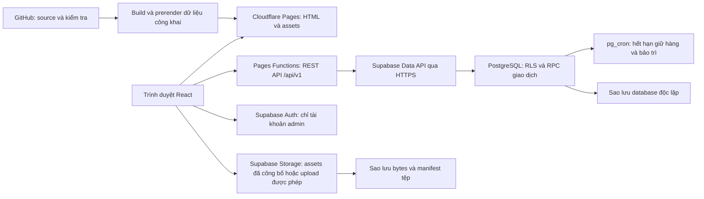

# ARCHITECTURE — Kiến trúc website thương mại điện tử

Phiên bản 0.3 · Giai đoạn 05, cập nhật phạm vi 08.1–08.2 · 06/11/2026.

08.1–08.2 đã dựng Supabase local/schema theo yêu cầu mới. Chưa tạo project online, chưa thêm API nghiệp vụ hoặc quyền/Auth 08.3. [Phạm vi và bằng chứng hiện tại](docs/MODULE_08_1_2.md) phân biệt rõ ràng phần đã triển khai với thiết kế đích bên dưới.

**Trạng thái:** PROMPT 06 cho phép khởi tạo bộ khung theo kiến trúc này. Đã chọn React Router Framework Mode/Vite, prerender và Pages Functions để kiểm chứng local. Quyền này không tự đóng các quyết định kinh doanh còn thiếu hoặc cho phép triển khai giao dịch/production. Kết quả thực nghiệm của bộ khung được ghi riêng trong [VERIFICATION](docs/VERIFICATION.md).

## 1. Kết luận thiết kế

Giữ stack đã yêu cầu. React/Vite/TypeScript/Tailwind cung cấp giao diện; Cloudflare Pages phát hành HTML và tài nguyên; Pages Functions làm REST API cùng tên miền; Supabase cung cấp PostgreSQL, Auth quản trị và Storage. Các thao tác tiền/tồn/đơn chạy trong **một database function, một giao dịch PostgreSQL**, không ghép nhiều lần gọi HTTP thành một giao dịch giả.

Trang catalog được prerender ở lúc build, sau đó React tải giá/tồn hiện hành để mua hàng. Giỏ/checkout/báo giá/admin là giao diện tương tác gọi API. Khách mua không cần Supabase Auth; quyền xem đơn dùng phiên guest và token riêng, chỉ xem dữ liệu đã che.

PROMPT 05 cho phép thiết kế kiến trúc; không đồng nghĩa tự duyệt hướng hình ảnh A ở Giai đoạn 04, dữ liệu kinh doanh hoặc cho phép lập trình. Người dùng đã trả lời **“Chưa có”** về tải/SKU, thời hạn giữ hàng và RPO/RTO. Thiết kế giữ các giá trị đó mở; không điền số rồi coi là đã chốt.

## 2. Bộ tài liệu và quy ước

| Tệp | Nội dung |
|---|---|
| [DATABASE.md](DATABASE.md) | Bảng/cột, thuộc tính, constraints, indexes, migration và giao dịch |
| [API.md](API.md) | Hợp đồng health hiện có; REST nghiệp vụ còn cần đặc tả theo từng module |
| [ERD](architecture/ERD.md) | Quan hệ catalog, giao dịch, quyền truy cập bằng Mermaid |
| [SECURITY.md](architecture/SECURITY.md) | Default-deny đã có; Auth, authorization, RLS nghiệp vụ và quyền guest tiếp tục ở 08.3 |
| `architecture/ENVIRONMENTS.md` — chưa tạo | Bản khởi tạo hiện có `.env.example`, `.dev.vars.example` và README |
| `architecture/OPERATIONS.md` — chưa tạo | Backup/restore, quota và xử lý sự cố cần hoàn thiện trước production |
| `architecture/IMPLEMENTATION_PLAN.md` — chưa tạo | Bộ khung Giai đoạn 06 dùng [checklist riêng](docs/SETUP_CHECKLIST.md); không coi toàn bộ TECH đã đạt |

Đầu vào: [PRD](PRD.md), [stories](USER_STORIES.md), [backlog](PRODUCT_BACKLOG.md), [sitemap](SITEMAP.md), [thiết kế](DESIGN.md). Giữ 27 Must của MVP; không thêm tài khoản khách, cổng thanh toán, đa kho, ERP, tích hợp sàn, nhập Excel/CSV hoặc bộ máy suy tương thích.

- **Xác minh tài liệu:** có nguồn chính thức được đọc ngày 04/11/2026. Không tương đương đã chạy thử trên tài khoản/project thật.
- **Đề xuất:** quyết định kiến trúc, giới hạn API, lịch vận hành và phương án triển khai cần duyệt.
- **Chờ doanh nghiệp:** giá/thuế, địa bàn/phí, TTL giữ hàng, catalog/quyền dữ liệu, SLA, thời hạn lưu dữ liệu và RPO/RTO.
- **Chưa kiểm chứng thực nghiệm:** build, latency/CPU, RLS thực tế, concurrency, SEO HTML, backup restore và quota tài khoản.

Spec Kit được áp dụng qua AD/DB/API/SEC/OPS/MIG/TECH và truy vết tới C/A/S; Impeccable được giữ ở tính rõ ràng của trạng thái API/UX, đặc biệt chưa biết kết quả, hết hạn và dữ liệu thiếu. Chưa cài/chạy hai bộ công cụ.

## 3. Sơ đồ tổng thể và ranh giới tin cậy



Các mũi tên backup chỉ trách nhiệm vận hành, không khẳng định có dịch vụ backup sẵn. Không có database password, secret key hoặc token deploy trong trình duyệt. Thư mục Git chỉ chứa source/migrations/tài liệu sau này; không chứa dữ liệu khách hoặc bản backup.

### 3.1. Frontend

- React + TypeScript strict + Tailwind, React Router; tổ chức theo catalog, cart, checkout, quotes, support, admin; dùng component đã đặc tả ở Giai đoạn 04.
- Giá/tồn/đơn do API xác nhận. Giỏ có thể lưu SKU/số lượng ở máy khách; không lưu quyền xem đơn, địa chỉ hay thông tin tiền trong local storage của giỏ.
- React Router **Framework Mode dùng Vite, prerender và tắt runtime SSR** là phương án đề xuất. Giữ React/Vite, không đổi sang Next.js. Framework Mode là lựa chọn mới cần kiểm chứng ở TECH01; phiên bản packages chốt khi khởi tạo, không tự cài “latest” trong tài liệu này.
- Catalog dùng dữ liệu công khai lúc build và client loaders để làm mới. Mutation đi tới Pages Functions, không dùng server actions của router khi đã tắt runtime SSR.
- Tách chunk admin khỏi storefront; chỉ số/tệp riêng không nằm trong HTML prerender, hydration payload, sitemap hoặc cache công khai.

### 3.2. Backend tại Pages Functions

Trách nhiệm: giới hạn request → kiểm tra origin/CSRF hoặc JWT → xác thực cấu trúc đầu vào → chống lạm dụng → gọi RPC → ánh xạ lỗi có kiểm soát → trả DTO cần thiết. Không nhận raw SQL, tên cột tự do, giá tính bởi client hoặc actor ID do client tự nhận.

Ba client Supabase tách biệt theo request:

1. **Public read:** publishable key, RPC chỉ trả catalog đã công bố.
2. **Admin:** publishable key + access token người quản trị; database tiếp tục nhận đúng `auth.uid()`/AAL và kiểm tra quyền. Không đổi sang service role cho tiện.
3. **Trusted guest/system:** server secret key, chỉ các RPC guest checkout/RFQ/quyền xem đơn/rate limit đã allowlist. Có quyền rộng nên phải coi là ranh giới đặc quyền, không dựa vào RLS để bảo vệ client này.

Thêm secret `DATA_API_GATEWAY_SECRET` trên các request Data API, xác minh bằng pre-request hook trong PostgreSQL; trình duyệt không có secret này. Kiểm soát này ngăn bỏ qua BFF bằng URL Supabase REST trực tiếp. Nó **không thay thế** JWT, quyền/RLS hoặc kiểm soát Storage/Auth. Nguồn: [Supabase — securing API](https://supabase.com/docs/guides/api/securing-your-api).

### 3.3. PostgreSQL

- `app`: bảng nghiệp vụ, không expose Data API; RLS bật rõ trong migrations.
- `api`: schema duy nhất expose cho Data API ứng dụng, chỉ RPC/view được duyệt; không tự expose mọi bảng của `public`.
- `private`: permission helpers, gateway check, hàm nội bộ/cron; không expose, không cấp CREATE cho người gọi API.
- `auth`, `storage`, `cron`: schema do nền tảng quản lý; chỉ thêm policy/extension/hook được hỗ trợ, không sửa cấu trúc hệ thống tùy tiện.
- Read admin có RLS; write quan trọng chỉ qua RPC có authorization và transaction. `SECURITY DEFINER` là ngoại lệ được rà soát, có execute grant hẹp, search path cố định và kiểm tra quyền trong hàm. Xem SECURITY để biết rõ phần nào bypass RLS.

## 4. Tính tương thích Cloudflare — đã kiểm tra tài liệu

| Thành phần | Kết luận từ tài liệu | Quyết định / kiểm chứng còn thiếu |
|---|---|---|
| Pages Functions | Dùng Workers runtime, có compatibility date/Node subset | Web APIs `fetch`, Request/Response, URL, Web Crypto; không dùng server Express lắng nghe cổng |
| React/Vite/Tailwind | Build thành assets; prerender chạy trong môi trường build | Node dùng lúc build, không giả runtime edge là máy Node đầy đủ |
| Node compatibility | Tài liệu hiện tại: ngày tương thích từ 2026-08-04 bật Node compat mặc định; nhiều API vẫn chỉ hỗ trợ một phần/shim | Đề xuất pin 2026-11-04 khi tạo project, kiểm tra Wrangler/Pages thực tế; không sao chép cấu hình flag cũ một cách máy móc |
| Supabase | Data API/RPC và Auth qua HTTPS | Dùng client hỗ trợ fetch; không giữ TCP connection, không cần Prisma engine/driver native trong Functions |
| SQL transaction | Mỗi request PostgREST chạy trong transaction | Một RPC tạo đơn bao gồm kiểm tra và mọi thay đổi; nhiều REST requests không atomic |
| CPU/memory | Free Workers có giới hạn chặt, đặc biệt CPU 10 ms mỗi invocation | Không xử lý ảnh/PDF, prerender catalog, hash mật khẩu hoặc export lớn ở edge; đo JWT/JSON/crypto thực tế |
| Tác vụ định kỳ | Supabase Cron dùng pg_cron để chạy hàm SQL | Hết hạn giữ hàng chạy trong DB; không gán cron chạy nền cho vòng đời request Pages |
| File upload | Storage có API và RLS | Upload trực tiếp vào vùng staging có quyền; Pages không proxy bytes ảnh lớn |

Nguồn: [Pages Functions](https://developers.cloudflare.com/pages/functions/), [Node compatibility](https://developers.cloudflare.com/workers/runtime-apis/nodejs/), [Workers limits](https://developers.cloudflare.com/workers/platform/limits/), [PostgREST transactions](https://docs.postgrest.org/en/stable/references/transactions.html), [Supabase Cron](https://supabase.com/docs/guides/cron).

Giai đoạn 06 chỉ kiểm chứng toolchain, prerender và health endpoint local; xem [kết quả](docs/VERIFICATION.md). Các đề mục TECH01–TECH08 trước đây mới là dự kiến, chưa có kế hoạch kiểm thử nghiệp vụ hoàn chỉnh. Chưa kiểm chứng DB/RLS, tạo đơn đồng thời, tải/CPU production hoặc backup restore. Không tự đổi sang hosting trả phí nếu CPU/quota không đạt.

## 5. Đơn hàng, tồn và báo giá

| AD | Quyết định đề xuất | Lý do / truy vết |
|---|---|---|
| AD01 | BFF cùng origin và RPC giao dịch | C07–C10/S01/S02: giảm bề mặt công khai và giữ nhất quán |
| AD02 | Một pool tồn dành website; `available = on_hand - reserved` | A06/S01: không bán vượt tồn hoặc suy tồn từ cache |
| AD03 | Checkout preview không giữ hàng; tạo đơn mới giữ trong cùng transaction | C06–C08: giỏ không làm mất tồn |
| AD04 | Idempotency theo phiên/actor + operation + key; hash payload, unique constraint | S01: mất phản hồi và double-click không tạo bản ghi trùng |
| AD05 | Giá/thuế/phí server tính lại, snapshot bất biến tại đơn | C04/C07/A05: thay catalog không sửa lịch sử |
| AD06 | RFQ, bản báo giá và đơn là ba đối tượng khác nhau | C09/A09: RFQ/báo giá không giữ hàng hoặc ghi doanh thu |
| AD07 | Một họ báo giá chỉ chuyển tối đa một đơn, kể cả đổi phiên bản | A09: chống chuyển lại bằng key/phiên bản khác |
| AD08 | Guest session + grant theo đơn + link capability trong fragment, chỉ xem dữ liệu che | C10/S02: mã đơn/điện thoại không là mật khẩu |
| AD09 | EOL/ngừng bán chặn mọi đơn mới ở DB; đơn cũ giữ snapshot | C04/A03: có tồn không đồng nghĩa được bán |
| AD10 | Thuộc tính typed theo product type và SKU; JSON chỉ bổ trợ/snapshot | C02–C05/A02: lọc số/đơn vị đúng cho nhiều ngành |
| AD11 | Catalog prerender, giá/tồn live; không đưa Offer dễ lỗi thời vào HTML build | S04: SEO nội dung ổn định và thông tin bán trung thực |
| AD12 | Backup DB + bytes Storage + cấu hình độc lập, restore drill bắt buộc | S05: Free không là giải pháp phục hồi production đầy đủ |

### 5.1. Tóm tắt luồng tạo đơn

```mermaid
sequenceDiagram
    participant U as Khách
    participant F as Pages Functions
    participant D as PostgreSQL RPC
    U->>F: Tạo/reuse phiên guest, lấy CSRF
    U->>F: Preview SKU, số lượng, địa chỉ, phương thức
    F->>D: Tính tổng từ dữ liệu đã duyệt, không giữ hàng
    D-->>U: Qua F: tổng và fingerprint để rà soát
    U->>F: Submit với key, fingerprint và dữ liệu đã rà soát
    F->>F: Session, CSRF, Turnstile, giới hạn
    F->>D: Một RPC create_order
    D->>D: Khóa idempotency, giá/EOL, inventory theo thứ tự
    D->>D: Tính lại, kiểm tra đủ hàng, tạo đơn/items/grant/holds
    D-->>F: Commit một lần hoặc rollback toàn bộ
    F-->>U: Mã đơn đã tiếp nhận; chưa mặc định đã thanh toán
```

Chi tiết lock order, clock, retry, payment/expiry race và trả hàng ở DATABASE. Không dùng `waitUntil`, cache, cron hoặc nhiều update REST để vá phần transaction còn thiếu.

### 5.2. Cấu hình kinh doanh chưa chốt

`commerce_policy_versions` lưu bản đã duyệt: TTL COD/chuyển khoản, giới hạn số lượng, vùng/phí/tax rule, điều kiện COD, phiên bản ngân hàng/điều khoản. Phiên bản thiếu trường bắt buộc không được kích hoạt checkout. Không tự lấy TTL bằng 0/null để bán không giới hạn.

Các đề xuất kỹ thuật như payload 64 KiB, tối đa 50 dòng/đơn, page size 24 tối đa 60, cron kiểm tra mỗi phút là **guardrail để kiểm chứng**, không phải số SKU/tải thực hoặc TTL của doanh nghiệp. Có thể điều chỉnh có kiểm soát; không thay D03–D07/D12 bằng số thử nghiệm.

## 6. SEO và prerender

### 6.1. Phương án được đề xuất

SPA thuần có thể được Google render nhưng nội dung phải qua bước xử lý JavaScript; không phải mọi bot đều chạy JS. HTML sẵn phù hợp catalog cần chia sẻ/link preview. [Google JavaScript SEO](https://developers.google.com/search/docs/crawling-indexing/javascript/javascript-seo-basics).

React Router hỗ trợ prerender ra HTML/data và SPA fallback khi tắt runtime SSR; loaders chạy ở build, không có runtime actions. Đây là lý do chọn phương án hybrid static + API, thay vì triển khai SSR mọi request trên Free CPU. [React Router prerender](https://reactrouter.com/how-to/pre-rendering), [Vite SSR](https://vite.dev/guide/ssr.html).

| Trang | Render và index |
|---|---|
| Trang chủ, danh mục gốc/con, thương hiệu, PDP, chính sách/giới thiệu/liên hệ | Prerender chỉ dữ liệu public đã duyệt, metadata/canonical/H1/link thật; đưa URL phù hợp vào sitemap |
| Trang danh sách phân trang chuẩn | Sinh HTML cho các trang được index, canonical riêng theo SITEMAP; route manifest ghi cả các tổ hợp phân trang được duyệt |
| Filter/sort/search/so sánh | Shell hoặc HTML cơ sở + client data; noindex có thể đọc được, không chặn robots rồi trông chờ crawler đọc noindex |
| Giỏ/checkout/RFQ/receipt/status/admin | Shell không có PII; noindex, private API no-store; route có quyền vẫn kiểm tra quyền thực tế |
| Slug không có | HTTP 404 thật; không trả homepage status 200 cho mọi đường dẫn |
| EOL công khai | Có trang nội dung hỗ trợ với nhãn EOL, không CTA mua; không tự 404 khi vẫn có giá trị tra cứu |

URL có query vẫn theo SITEMAP. Build sinh nội dung trang chuẩn; nếu `?page=n` cần HTML khác trong khi hosting định tuyến theo path, route adapter ở Pages Functions chọn asset đã build cho trang n và giữ canonical URL query. Không giả static hosting tự chọn file theo query. Nếu chưa làm adapter, chỉ index trang có HTML đúng và điều chỉnh phạm vi SEO trước duyệt triển khai; không khai đã hỗ trợ pagination SEO đầy đủ.

### 6.2. Tính mới của dữ liệu

- Snapshot build chỉ chứa tên, mô tả/thông số đã duyệt, ảnh public, policy, route/revision. Không bake nút mua được phép, số tồn, giá và bank details thành dữ liệu đáng tin cậy lâu dài.
- Giá/tồn tải riêng, không-cache cho quyết định mua. Khi chưa tải được: “Đang xác nhận giá/tình trạng”, không 0 đồng hoặc còn hàng giả. Checkout luôn revalidate.
- Structured data ban đầu chỉ dùng thuộc tính ổn định, không rating/review/Offer thiếu căn cứ. Chưa cam kết đủ điều kiện rich result giá. Nếu sau này thêm Offer cần chiến lược freshness và kiểm tra schema riêng.
- Sửa nội dung công khai/ẩn sản phẩm tạo publication revision và yêu cầu rebuild có gom nhóm; không rebuild mỗi biến động tồn. Admin thấy “Đã lưu / Chờ phát hành / Đã phát hành”, không nhầm DB save với HTML đã cập nhật.
- Bản build phải lấy một snapshot revision nhất quán qua RPC export chỉ public. Số tệp/thời gian build còn phải đo với số SKU thật.
- API chặn SKU ẩn/EOL ngay. Nếu cần gỡ nội dung HTML/ảnh ngay vì quyền sử dụng hoặc dữ liệu nhạy cảm, chỉ rebuild bất đồng bộ là chưa đủ: quy trình khẩn cấp ở OPERATIONS chặn đường dẫn, triển khai bản loại bỏ và xử lý asset; không chờ client hydration che nội dung.

### 6.3. Routing/header cần kiểm chứng

Pages mặc định có SPA fallback nếu thiếu `404.html`. Thiết kế dùng `404.html` thật, rewrite **chỉ các route SPA đã allowlist** tới fallback, không dùng catch-all 200 che lỗi URL. HTML tĩnh và `.data` prerender được phục vụ trước fallback; `/api/v1/*` luôn đi Functions. Nguồn: [Serving Pages](https://developers.cloudflare.com/pages/configuration/serving-pages/), [Functions routing](https://developers.cloudflare.com/pages/functions/routing/).

Filter/query noindex: metadata do route đặt; khi cần `X-Robots-Tag` tùy query phải qua Function, không dựa vào file header tĩnh vốn không xử lý mọi nhánh query. Security/cache headers trên API phải do Function trả; không mặc định `_headers` áp dụng lên Function responses. Kiểm thử đường dẫn có dấu slash, deep link, query, 404, redirects, `.data`, và HTML không JS trước go-live.

## 7. Điều kiện duyệt và rủi ro còn mở

| Quyết định | Đề xuất có thể duyệt ngay | Phần chưa được phép tự chốt |
|---|---|---|
| AD01–AD10 | Ranh giới BFF/RPC, schema, idempotency, quyền, typed attributes | Cấu hình TTL/thuế/phí, quy trình khôi phục quyền guest, số hàng thực |
| AD11 | Prerender public + SPA private + REST API | Khối lượng build, thời hạn phát hành nội dung, phiên bản toolchain |
| AD12 | Backup ngoài project, restore thử trước giao dịch thật | RPO/RTO, nơi giữ backup, người trực, ngân sách nếu Free không đạt |
| UI01–UI08 | Dùng cấu trúc màn hình hiện có làm input | PROMPT 05 không tự chọn A/B/C thay người dùng |

Có thể duyệt **kiến trúc có điều kiện** để chuẩn bị implementation. PROMPT 06 đã cho phép bộ khung local; chưa thể duyệt mức sẵn sàng production khi D03–D07/D12 chưa được chốt và các kiểm chứng nghiệp vụ chưa chạy. Chưa mua gói, tạo cloud project hoặc viết SQL migration.
