# SITEMAP — Kiến trúc thông tin và luồng sử dụng

Phiên bản 0.1 · Giai đoạn 03 · 04/11/2026 · Asia/Bangkok.

**Trạng thái: Đã lập thiết kế để rà soát; chưa có giao diện hoặc code được triển khai.** PROMPT 03 xác nhận BRD/PRD đã duyệt làm cơ sở. Trong workspace, BUSINESS_ANALYSIS.md đảm nhiệm phần phân tích nghiệp vụ/BRD; không có một BRD.md riêng.

Đầu vào: [BUSINESS_ANALYSIS.md](BUSINESS_ANALYSIS.md), [PRODUCT_CATALOG_PLAN.md](PRODUCT_CATALOG_PLAN.md), [PRD.md](PRD.md), [PRODUCT_BACKLOG.md](PRODUCT_BACKLOG.md), [USER_STORIES.md](USER_STORIES.md).

## 1. Phạm vi và nguyên tắc

- Bám 27 Must Have của MVP đã được chấp thuận làm đầu vào qua PROMPT 03; không kéo Should/Nice vào MVP. Câu hỏi dữ liệu và tham số nghiệp vụ D02–D12 của PRD vẫn cần được chốt đúng mốc.
- Website mới độc lập với XTREND. Tên thương hiệu/tên miền chưa xác nhận; mọi URL bên dưới là đường dẫn tương đối của website mới, không mô phỏng cấu trúc XTREND.
- Spec Kit: dùng mã trang P/U/X, mã luồng F và truy vết sang chức năng C/A/S, giữ các điều kiện nghiệm thu kiểm tra được.
- Impeccable: ưu tiên tìm và chọn đúng hàng, hành động mua/báo giá rõ, giữ bối cảnh, nội dung tiếng Việt dễ hiểu và trạng thái không gây hiểu nhầm. Chưa chọn font, màu hoặc thiết kế visual của Giai đoạn 04.
- “Trang” là màn hình/template hoặc khu vực nghiệp vụ; không phải mỗi đường dẫn là một file. Dialog, tab, bộ lọc và drawer không tự trở thành trang độc lập.
- Sitemap trong tài liệu là cây điều hướng của người dùng. `sitemap.xml` là danh sách URL cho công cụ tìm kiếm ở giai đoạn triển khai, không bao gồm mọi trang trong cây.

## 2. Sitemap dạng cây

Các danh mục con và thương hiệu dưới đây là cấu trúc dự kiến theo catalog plan. Chỉ đưa vào menu khi có dữ liệu/quyền sử dụng đã duyệt; không khẳng định các nhóm đều có hàng hoặc sẽ cùng ra mắt.

```text
Website mới [MVP]
├── Trang chủ /                                              [P01]
├── Danh mục /danh-muc/                                      [P02]
│   ├── UPS & thiết bị nguồn /danh-muc/ups-thiet-bi-nguon/     [P03: nhóm cha]
│   │   ├── UPS Line Interactive /danh-muc/ups-line-interactive/
│   │   ├── UPS Online một pha /danh-muc/ups-online-mot-pha/
│   │   ├── UPS Online ba pha /danh-muc/ups-online-ba-pha/
│   │   ├── IPS /danh-muc/ips/
│   │   └── Phụ kiện UPS /danh-muc/phu-kien-ups/ [có điều kiện]
│   ├── Máy in & vật tư /danh-muc/may-in-vat-tu/               [P03: nhóm cha]
│   │   ├── Máy in đơn năng /danh-muc/may-in-don-nang/
│   │   ├── Máy in đa năng /danh-muc/may-in-da-nang/
│   │   └── Vật tư máy in /danh-muc/vat-tu-may-in/ [có điều kiện]
│   ├── Linh kiện & phụ kiện /danh-muc/linh-kien-phu-kien/     [P03: nhóm cha]
│   │   ├── RAM /danh-muc/ram/
│   │   ├── SSD /danh-muc/ssd/
│   │   ├── Mainboard /danh-muc/mainboard/
│   │   ├── Nguồn máy tính /danh-muc/nguon-may-tinh/
│   │   ├── Case /danh-muc/case-may-tinh/
│   │   ├── Tản nhiệt khí /danh-muc/tan-nhiet-khi/
│   │   ├── Tản nhiệt AIO /danh-muc/tan-nhiet-aio/
│   │   └── Phụ kiện /danh-muc/phu-kien-may-tinh/ [có điều kiện]
│   └── Mạng & công nghiệp /danh-muc/mang-cong-nghiep/         [P03: nhóm cha]
│       ├── Switch công nghiệp /danh-muc/switch-cong-nghiep/
│       ├── Switch PoE công nghiệp /danh-muc/switch-poe-cong-nghiep/
│       └── Wi-Fi di động /danh-muc/wifi-di-dong/
├── Tất cả sản phẩm /san-pham/                               [P04]
│   └── Chi tiết /san-pham/{product-slug}/                    [P08]
│       ├── Lựa chọn SKU ?sku={public-sku}
│       ├── Thông số #thong-so
│       ├── Tài liệu & hướng dẫn #tai-lieu
│       └── Bảo hành #bao-hanh
├── Thương hiệu /thuong-hieu/                                [P05]
│   └── /thuong-hieu/{brand-slug}/                           [P06]
│       └── Lọc loại hàng ?danh-muc={category-slug}
├── Tìm kiếm /tim-kiem/?q={tu-khoa}                           [P07]
├── So sánh /so-sanh/?sku={sku-a}&sku={sku-b}                  [P09]
├── Giỏ hàng /gio-hang/                                      [P10]
│   └── Đặt hàng /dat-hang/                                  [P11]
│       └── Đã tiếp nhận /dat-hang/da-tiep-nhan/               [P12: có ngữ cảnh hợp lệ]
├── Theo dõi đơn /don-hang/theo-doi/                          [P13: quyền riêng]
├── Yêu cầu báo giá /bao-gia/                                [P14]
│   └── Đã tiếp nhận /bao-gia/da-tiep-nhan/                   [P15: có ngữ cảnh hợp lệ]
├── Hỗ trợ /ho-tro/                                         [P16]
│   └── Hướng dẫn sử dụng /ho-tro/huong-dan-su-dung/           [P17]
│       └── Tìm model bằng P07 → P08 #tai-lieu
├── Chính sách /chinh-sach/                                  [P26]
│   ├── Bảo hành /chinh-sach/bao-hanh/                        [P18]
│   ├── Kiểm hàng & đổi trả /chinh-sach/doi-tra/              [P19]
│   ├── Giao hàng /chinh-sach/van-chuyen/                     [P20]
│   ├── Thanh toán /chinh-sach/thanh-toan/                    [P21]
│   ├── Bảo vệ thông tin /chinh-sach/bao-mat/                 [P22]
│   └── Điều kiện giao dịch /chinh-sach/dieu-kien-giao-dich/  [P23]
├── Liên hệ /lien-he/                                        [P24]
├── Giới thiệu /gioi-thieu/                                  [P25]
└── Quản trị /quan-tri/ [không có trong menu mua hàng]
    ├── Đăng nhập /quan-tri/dang-nhap/                        [U01]
    ├── Khôi phục /quan-tri/khoi-phuc-truy-cap/                [U02]
    ├── Tổng quan /quan-tri/                                 [U03]
    ├── Sản phẩm /quan-tri/san-pham/                          [U04]
    │   ├── Thêm /quan-tri/san-pham/them/                     [U05]
    │   └── Sửa /quan-tri/san-pham/{product-id}/              [U05]
    ├── Danh mục /quan-tri/danh-muc/                          [U06]
    ├── Thương hiệu /quan-tri/thuong-hieu/                    [U07]
    ├── Thuộc tính /quan-tri/thuoc-tinh/                      [U08]
    ├── Ảnh & tài liệu /quan-tri/tep-tin/                     [U09]
    ├── Chính sách bảo hành /quan-tri/bao-hanh/               [U10]
    ├── Giá /quan-tri/gia/                                   [U11]
    ├── Tồn kho /quan-tri/ton-kho/                           [U12]
    │   └── Chi tiết SKU /quan-tri/ton-kho/{sku-id}/          [U12]
    ├── Đơn hàng /quan-tri/don-hang/                         [U13]
    │   └── Chi tiết /quan-tri/don-hang/{order-id}/           [U14]
    ├── Yêu cầu báo giá /quan-tri/yeu-cau-bao-gia/            [U15]
    │   └── Chi tiết /quan-tri/yeu-cau-bao-gia/{request-id}/  [U16]
    ├── Báo giá /quan-tri/bao-gia/{quote-id}/phien-ban/{v}/   [U17]
    │   └── Bản in .../phien-ban/{v}/ban-in/                 [U18]
    ├── Đối soát tiền /quan-tri/thanh-toan/                   [U19]
    ├── Sau bán /quan-tri/sau-ban/                           [U20]
    │   └── Chi tiết /quan-tri/sau-ban/{case-id}/            [U20]
    ├── Nội dung cơ bản /quan-tri/noi-dung/                  [U21]
    ├── Nhân sự & quyền /quan-tri/nhan-su/                   [U22]
    ├── Thiết lập /quan-tri/cai-dat/                         [U23]
    └── Nhật ký /quan-tri/nhat-ky/                          [U24]
```

Trang không tồn tại, không có quyền và tạm ngừng phục vụ là trạng thái tại URL được yêu cầu, không ép chuyển tất cả về trang chủ. Xem X01–X03 ở mục 6.

## 3. Cấu trúc URL và mở rộng danh mục

### 3.1. Quy ước URL

1. Đường dẫn công khai dùng chữ thường không dấu, từ cách bằng dấu gạch nối; thống nhất dấu `/` cuối đường dẫn trang. Tệp có phần mở rộng như `sitemap.xml` không thêm `/`.
2. Chỉ một URL chính cho mỗi sản phẩm: `/san-pham/{product-slug}/`. Không tạo URL sản phẩm lặp bên trong danh mục và thương hiệu.
3. Danh mục có cấu trúc cha–con trong dữ liệu/điều hướng nhưng URL là `/danh-muc/{category-slug}/`. Đổi cha không bắt buộc đổi URL. Slug danh mục phải duy nhất trong namespace này; mã nội bộ không phụ thuộc tên hiển thị.
4. Thương hiệu có hub và trang riêng `/thuong-hieu/{brand-slug}/`; ví dụ `prolink`, `cyberpower`, `pantum`, `trm`, `dynabook`, `biostar`, `cooler-master`, `antec`, `simorchip`, `ison` chỉ công bố sau duyệt. ASUS/Advantech chờ phạm vi sản phẩm được xác nhận.
5. Sản phẩm giữ URL khi đổi tên nhẹ hoặc đổi danh mục. Nếu buộc đổi slug, chuyển hướng vĩnh viễn từ URL cũ sang đúng nội dung thay thế, cập nhật liên kết/canonical; không chuyển hàng loạt sản phẩm mất sang trang chủ.
6. Biến thể MVP dùng `?sku={public-sku}` để chọn rõ đơn vị bán; không tự tạo trang SEO riêng cho mỗi biến thể. Sai SKU hoặc SKU không thuộc sản phẩm phải báo và yêu cầu chọn lại, không tự mua biến thể khác.
7. Các `{id}` admin là định danh ổn định, không phải bằng chứng có quyền. Namespace `them` và các từ khóa hệ thống được dành riêng, không xung đột định danh dữ liệu.
8. Không đặt tên khách, điện thoại, email, địa chỉ, số tài khoản hoặc nội dung báo giá vào URL. Không đặt giá/tổng tiền ở query như nguồn xác nhận giao dịch.
9. Đường dẫn P12/P13/P15 không công khai mã giao dịch hay credential trong mẫu route. Cơ chế trao và đổi quyền xem liên kết được chốt tại Giai đoạn 05 theo D07; không đưa token vào query, log, referrer hoặc analytics. URL sạch không thay thế kiểm tra quyền.
10. Các anchor trên trang là định vị nội dung, không phải route mới: `#thong-so`, `#tai-lieu`, `#bao-hanh`; admin có `#giao-hang`, `#thanh-toan`, `#sau-ban`, `#lich-su` theo quyền.

Mẫu minh họa URL không phải dữ liệu bán hàng: `/danh-muc/ram/?thuong-hieu=trm&ddr=ddr4&dung-luong-gb=16`; `/thuong-hieu/pantum/?danh-muc=may-in-don-nang`; `/tim-kiem/?q={model}`. Giá trị hiển thị và key bộ lọc phải được duyệt từ A02; không suy diễn thông số của sản phẩm thật từ ví dụ này.

### 3.2. Query và trạng thái có thể chia sẻ

| Mục đích | Query/anchor | Quy tắc |
|---|---|---|
| Tìm kiếm | `q` | Giữ chữ/mã khách nhập ở UI; mã hóa URL đúng; không tự xóa dấu phân cách SKU |
| Chọn loại trong tìm kiếm/thương hiệu | `danh-muc` | Chỉ một loại hoạt động để hiện bộ lọc kỹ thuật tương ứng |
| Nhiều thương hiệu/giá trị cùng thuộc tính | `thuong-hieu=a&thuong-hieu=b`, key thuộc tính lặp | OR trong cùng key, AND giữa các key; bỏ giá trị lặp, thứ tự chuẩn ổn định |
| Khoảng số | Ví dụ `cong-suat-w-tu`, `cong-suat-w-den` | Key/đơn vị theo từ điển; hai đầu được bao gồm; đầu dưới lớn hơn đầu trên báo lỗi, không gửi truy vấn sai |
| Sắp xếp | `sap-xep=gia-tang`, `gia-giam`, `ten` | Mặc định theo ngữ cảnh; không giá đặt sau nhóm có giá; bỏ giá trị mặc định khỏi URL |
| Phân trang | `trang=2` | Số nguyên dương, trang 1 bỏ query; đổi tìm/lọc/sắp xếp đưa về trang 1 |
| Biến thể | `sku` trên P08 | Phải thuộc sản phẩm và còn công bố; không làm mất các anchor |
| So sánh | Các `sku` trên P09 | 2–3 SKU cùng loại; không chứa thông tin riêng; kiểm lại trạng thái khi mở |
| Chuyển sản phẩm sang báo giá | `sku` tùy chọn trên P14 | Chỉ gợi ý một dòng hàng; số lượng/nội dung được xác nhận trong form, không tự gửi yêu cầu |

Từ khóa tìm kiếm có thể vô tình chứa PII: không thu query thô vào analytics, có quy tắc loại bỏ ở log trước vận hành. Form giao dịch không chia sẻ bản nháp bằng URL. Query không hợp lệ phải được xử lý rõ; không âm thầm áp lọc khác ý định khách.

Danh mục cha chứa nhiều loại chỉ có lọc chung như thương hiệu; chọn loại con mới bật thông số riêng. Breadcrumb sản phẩm luôn theo danh mục chính đã duyệt, ví dụ Trang chủ → Linh kiện → RAM → Sản phẩm; nhãn “Quay lại kết quả” lưu bối cảnh tìm/lọc riêng, không thay breadcrumb theo mọi đường đi.

### 3.3. Chính sách SEO và index đề xuất

“Index” là đủ điều kiện công cụ tìm kiếm lập chỉ mục, không bảo đảm được lập chỉ mục/xếp hạng. `canonical` là URL chính ưu tiên; `noindex` là yêu cầu loại khỏi kết quả tìm kiếm, không phải cơ chế bảo mật.

| Nhóm URL | Index/canonical đề xuất | `sitemap.xml` |
|---|---|---|
| P01–P06 bản không lọc, P08, P16–P26 | Có khi nội dung công bố đủ chất lượng; self-canonical trên URL chuẩn | Có cho URL chuẩn công khai đủ điều kiện |
| Phân trang danh sách không lọc/sắp xếp tùy chọn | Mỗi trang có URL và self-canonical riêng, liên kết trang trước/sau có thể truy cập; không canonical mọi trang về trang 1 | Không bắt buộc liệt kê mọi trang phân trang; sản phẩm phải được liên kết và có URL trong sitemap |
| Bộ lọc, sắp xếp, tổ hợp thương hiệu–loại | MVP không index; chuẩn hóa query. Nếu khai canonical thì dùng URL trạng thái chuẩn chính nó, không ép một tập sản phẩm khác về danh mục gốc | Không |
| P07 tìm kiếm; P09 so sánh | Không index; không tạo trang SEO từ truy vấn/so sánh bất kỳ | Không |
| P08 với `sku` | Canonical về URL sản phẩm gốc trong mô hình một trang sản phẩm MVP; không thêm trang biến thể vào sitemap | Chỉ URL gốc |
| P10–P15 giao dịch, toàn bộ U và trạng thái X | Không index; dữ liệu riêng còn cần phiên/quyền server. Không đặt canonical chứa credential hoặc PII | Không |
| EOL còn nội dung hỗ trợ hữu ích | Giữ URL và nội dung trung thực; có thể index nếu được biên tập duyệt; không tạo khả năng mua hoặc schema hàng sẵn bán | Chỉ nếu vẫn công khai và đủ điều kiện |
| Nháp/ẩn, URL không tồn tại, trang thật đã xóa | Không lộ nội dung nháp; đúng trạng thái truy cập/không tồn tại, không trả trang chủ giả thành công | Không |

Với MVP nhỏ, đề xuất dùng `noindex` trên các trạng thái lọc/sắp xếp và giới hạn sinh tổ hợp liên kết; chưa chặn crawl các URL đó bằng robots.txt để crawler còn đọc được noindex. Khi catalog lớn, phải đánh giá lại crawl budget ở Giai đoạn 05; không coi noindex là biện pháp tiết kiệm crawl. Không dùng canonical về trang khác nội dung chỉ để loại URL lọc. Các kết quả lọc hợp lệ nhưng rỗng trả UX rỗng, không tự tạo landing page SEO.

Query tracking không đổi nội dung bị loại khỏi canonical; tham số cấu trúc sai hoặc trang phân trang ngoài phạm vi trả trạng thái phù hợp, có đường quay lại trang đầu. Trang thật tạm hết hàng không biến thành 404. Tệp hướng dẫn chỉ được công khai khi quyền sử dụng cho phép; lựa chọn index tệp là quyết định nội dung riêng, không tự đưa mọi tệp Storage vào sitemap.

Cơ sở đối chiếu ngày 04/11/2026: Google khuyên URL/canonical riêng cho các trang phân trang và liên kết có thể crawl. [Hướng dẫn phân trang](https://developers.google.com/search/docs/specialty/ecommerce/pagination-and-incremental-page-loading). Canonical phù hợp cho nội dung trùng hoặc rất gần nhau. [Canonical](https://developers.google.com/search/docs/crawling-indexing/consolidate-duplicate-urls). URL lọc có thể tạo không gian crawl quá lớn. [Faceted navigation](https://developers.google.com/crawling/docs/faceted-navigation). Crawler phải đọc được noindex để thực hiện; robots.txt không phải bảo vệ dữ liệu. [Noindex](https://developers.google.com/search/docs/crawling-indexing/block-indexing).

## 4. Điều hướng desktop và mobile

### 4.1. Desktop

- Header: logo/tên thương hiệu mới về P01; ô tìm kiếm; liên kết “Yêu cầu báo giá”; “Hỗ trợ”; giỏ hàng có số lượng. Không có “Tài khoản” khi C14 chưa làm.
- Navigation: Danh mục, Thương hiệu, Tất cả sản phẩm. Danh mục nhóm theo bốn ngành chính; mở bằng click hoặc bàn phím, không phụ thuộc hover. Nhóm con có trang xem tất cả; không hiển thị menu hãng/ngành chưa duyệt.
- Danh sách: breadcrumb, tiêu đề/số kết quả, lọc cạnh danh sách, sắp xếp, sản phẩm, phân trang. Thanh so sánh chỉ xuất hiện khi có lựa chọn.
- Chi tiết: thông tin mua và trạng thái nằm cạnh nội dung chính; anchor đi tới thông số/tài liệu/bảo hành. Giá thiếu không biến thành giá 0. “Mua ngay” không đồng nghĩa được cấp hàng mà không qua checkout.
- Footer: giới thiệu/pháp nhân đã duyệt, liên hệ, hỗ trợ, các chính sách; không gắn logo hãng/chứng nhận khi chưa có quyền.
- Checkout dùng header giản lược, vẫn có quay lại giỏ và liên kết hỗ trợ/chính sách; không đặt banner điều hướng gây mất dữ liệu nhập.

### 4.2. Mobile

- Header gọn: menu, thương hiệu, giỏ; ô tìm kiếm ở vị trí dễ thấy. Menu drawer có Danh mục → nhóm → loại, Thương hiệu, Báo giá, Hỗ trợ; mỗi cấp có quay lại và xem tất cả.
- Menu đóng bằng nút, Escape khi có bàn phím; focus đi vào drawer và trả về nút mở khi đóng. Cuộn danh sách menu không làm mất vị trí trang phía sau.
- Danh sách có nút “Lọc” với số lọc đang áp và “Sắp xếp”. Lọc trong drawer: chỉnh bản nháp → “Áp dụng” mới cập nhật danh sách/URL; “Hủy” giữ bộ lọc cũ; “Xóa lọc” chỉ có hiệu lực khi áp dụng. Sau áp dụng về đầu kết quả, thông báo số lượng.
- Desktop và mobile dùng cùng quy tắc lọc và URL. Back/Forward khôi phục từ khóa, bộ lọc đã áp, trang và vị trí cuộn khi dữ liệu cho phép; không giữ kết quả lỗi thời như dữ liệu hiện hành.
- Trên P08 có thanh hành động khi cần: mua hoặc báo giá tùy điều kiện SKU. Thanh không che lỗi, nội dung hoặc bàn phím. Không hiện cả menu đáy, thanh so sánh và thanh mua chồng nhau.
- Bảng so sánh cuộn trong vùng riêng, có tên SKU và nhãn hàng giúp biết đang xem cột nào. Không ép thu nhỏ chữ để vừa mọi cột.
- Checkout theo một trang có các khu vực liên hệ → giao → thanh toán → rà soát, không ép tạo tài khoản. Nút đặt hàng có mô tả hành động, chỉ chuyển thành công khi server xác nhận.

### 4.3. Admin

- Sidebar nhóm Catalog; Bán hàng; Kho & tiền; Nội dung; Hệ thống. Chỉ hiển thị phần có quyền nhưng server vẫn kiểm tra quyền với URL trực tiếp.
- Người có dashboard vào U03; người chỉ có quyền tác nghiệp được dẫn tới hàng chờ được phép, không xem số doanh thu chỉ vì đăng nhập thành công. Chưa có quyền nào thì hiện trạng thái liên hệ chủ hệ thống.
- Tab đơn: tổng quan, giao hàng, thanh toán, sau bán, lịch sử. Tab và hành động nhạy cảm có quyền riêng; quyền kho không tự có quyền tiền.
- Mobile admin ưu tiên xem hàng chờ/chi tiết và thao tác có kiểm soát. Bảng rộng được cuộn/hiển thị dòng thành thẻ nhưng vẫn đủ thông tin xác nhận. Không cho phép thao tác phá dữ liệu chỉ vì chuyển layout.
- Rời form có thay đổi chưa lưu thì cảnh báo, cho ở lại/lưu nháp nếu có quyền; phiên hết hạn yêu cầu đăng nhập lại và đối chiếu bản mới trước thao tác lại, không tự gửi lại xác nhận tiền/xuất kho.

## 5. Danh sách trang khách hàng và đặc tả

Mọi trang trong bảng là MVP, trừ khi ghi khác. Hồ sơ trạng thái `ST-*` được định nghĩa ở mục 7 và áp dụng cùng ngoại lệ từng dòng. “Index” chính xác theo mục 3.3, không chỉ theo tên trang.

| ID / URL | Nội dung bắt buộc | Hành động/chuyển tiếp | Trạng thái và giới hạn riêng | Truy vết |
|---|---|---|---|---|
| P01 `/` | Định vị kinh doanh đã duyệt; nhóm ngành; lựa chọn tìm/duyệt; lối B2B; hỗ trợ/chính sách | Tìm P07, chọn P03/P06/P08, báo giá P14 | ST-CONT/ST-LIST; block sản phẩm lỗi không làm mất header; không tự gắn “bán chạy” hoặc ưu đãi thiếu dữ liệu | C01, C09, C11 |
| P02 `/danh-muc/` | Bốn nhóm ngành và loại đã công bố | P03; truy cập bằng menu hoặc trang riêng | ST-LIST; không công bố nhóm chưa có dữ liệu chỉ để đủ cây | C01 |
| P03 `/danh-muc/{category-slug}/` | Tên/mô tả ngắn, breadcrumb, nhóm con nếu có, số kết quả, lọc/sort, thẻ sản phẩm, phân trang | Chọn nhóm con; lọc F05; P08/P09 | ST-LIST; nhóm cha hỗn hợp chỉ có lọc chung; khác mẫu thuộc tính không cho so sánh | C01, C03, C05 |
| P04 `/san-pham/` | Tất cả sản phẩm công bố; chọn loại/brand; thông tin trạng thái | Chọn loại để lọc kỹ thuật; P08 | ST-LIST; không dùng bộ lọc kỹ thuật chung cho mọi ngành | C01, C03 |
| P05 `/thuong-hieu/` | Tên hãng theo thứ tự dễ tìm; logo chỉ khi được phép | P06 | ST-LIST; chưa duyệt không xuất hiện; không ngụ ý đại lý/nhà phân phối chính thức | C01 |
| P06 `/thuong-hieu/{brand-slug}/` | Tên hãng, giới thiệu đã duyệt nếu có, các loại hàng của hãng, danh sách | Chọn loại trong hãng; lọc; P08 | ST-LIST; giữ ràng buộc hãng khi đổi loại; không suy quyền phân phối | C01–C03 |
| P07 `/tim-kiem/?q=...` | Từ khóa, số kết quả, loại/brand, SKU/model khớp và nhãn biến thể | Sửa từ khóa, chọn loại/lọc, P08 với SKU, so sánh | ST-LIST; query rỗng chỉ mời nhập, không hiện “0 kết quả”; lỗi khác không tìm thấy; không lộ nháp | C02–C03 |
| P08 `/san-pham/{product-slug}/` | Tên/model/SKU, ảnh được phép, biến thể, đơn vị bán, giá/thuế, trạng thái, thông số, tài liệu, bảo hành, hỗ trợ | Thêm giỏ P10; Mua ngay P11; báo giá P14; so sánh P09; anchor tài liệu/bảo hành | ST-PDP; SKU sai yêu cầu chọn lại; không mua EOL/ẩn/chưa đủ dữ liệu; chính sách gắn SKU | C04–C06, C09, C11 |
| P09 `/so-sanh/?sku=...` | 2–3 SKU cùng loại, thông số và đơn vị, trạng thái và giá theo SKU | Thêm/bỏ lựa chọn, về P08, thêm giỏ nếu hợp lệ | ST-COMP; ít hơn 2 mời chọn thêm; hơn 3/khác loại báo rõ, không tự bỏ ngầm; SKU vừa ẩn loại có thông báo | C05 |
| P10 `/gio-hang/` | Dòng SKU/số lượng/đơn vị, giá mới kiểm tra, tổng dự kiến và phí chưa chốt | Chỉnh/xóa, tiếp tục mua, P11, lối báo giá thủ công P14 nếu cần | ST-CART; không giữ hàng; giỏ trống không checkout; mất giá/tồn buộc xử lý; không tự chuyển cả giỏ thành báo giá | C06 |
| P11 `/dat-hang/` | Liên hệ, địa chỉ, tùy chọn hóa đơn, giao/phí, COD/chuyển khoản, tổng, liên kết chính sách | Rà soát → đặt; về P10; P14 khi cần điều kiện đặc biệt | ST-FORM/ST-TXN; chưa có phí/địa bàn không nhận đơn trả tiền; tổng đổi cần đồng ý lại; không tạo tài khoản | C07–C08 |
| P12 `/dat-hang/da-tiep-nhan/` | Mã đơn thật, số tiền, “Chờ xác nhận”, phương thức và bước tiếp theo, quyền xem trạng thái | Lưu mã/quyền riêng; P13; tiếp tục mua | ST-RECEIPT; chỉ ngữ cảnh đã tạo thành công; refresh không đặt lại; không có ngữ cảnh không giả thành công | C07–C08, C10 |
| P13 `/don-hang/theo-doi/` | Trạng thái đơn/giao/tiền riêng, dòng hàng cần thiết, liên hệ che, hướng hỗ trợ | Xem cập nhật; liên hệ xác minh khi cần | ST-PRIVATE; chỉ có quyền hợp lệ; không tìm đơn công khai theo mã/điện thoại; không tự sửa/hủy/đọc đầy đủ PII | C10, S02 |
| P14 `/bao-gia/` | Giải thích yêu cầu không phải đơn; dòng SKU/số lượng hoặc bài toán; tên/kênh liên hệ; công ty/nơi giao/hạn cần tùy chọn | Gửi yêu cầu; quay lại sản phẩm; P15 | ST-FORM/ST-TXN; không upload; không yêu cầu mã số thuế để hỏi; không cam kết giá/giữ hàng/SLA chưa duyệt | C09 |
| P15 `/bao-gia/da-tiep-nhan/` | Mã yêu cầu thật, đã tiếp nhận, cách liên hệ/bước chờ xử lý | Lưu mã; P24 hoặc tiếp tục mua | ST-RECEIPT; không gọi mã đơn, không thanh toán, không tạo portal xem báo giá công khai | C09 |
| P16 `/ho-tro/` | Lối hướng dẫn, bảo hành, đổi trả, thanh toán, giao hàng, liên hệ | P17–P24; theo dõi P13 nếu có quyền | ST-CONT; không có live chat/chatbot/tra serial MVP | C11 |
| P17 `/ho-tro/huong-dan-su-dung/` | Cách tìm model, vị trí tài liệu trong P08, hướng nhận trợ giúp khi thiếu | Ô tìm dùng P07; P08 #tai-lieu; P24 | ST-CONT; trang hỗ trợ đơn giản, không thư viện upload/tìm PDF riêng hoặc CMS bài viết | C04, C11 |
| P18 `/chinh-sach/bao-hanh/` | Nguyên tắc đã duyệt, cách tìm chính sách đúng SKU, chứng từ và nơi tiếp nhận, phiên bản/ngày hiệu lực | P08 #bao-hanh; P24; dẫn P19 nếu đổi trả | ST-CONT; không áp một thời hạn chung thay chính sách model; thiếu chính sách không bịa | C11, A04 |
| P19 `/chinh-sach/doi-tra/` | Điều kiện kiểm hàng/đổi trả, chứng từ, chi phí và các bước liên hệ đã duyệt | P24; hỗ trợ theo đơn P13 | ST-CONT; không có nút tự động chấp thuận hoàn/đổi | C11 |
| P20 `/chinh-sach/van-chuyen/` | Vùng giao, phí/cách xác định, giới hạn hàng đặc thù và thời gian có căn cứ | P24/P14 nếu ngoài vùng/cần lắp đặt | ST-CONT; không hứa freeship hoặc giao toàn quốc khi chưa duyệt | C11 |
| P21 `/chinh-sach/thanh-toan/` | COD/chuyển khoản, điều kiện, cách đối soát, cảnh báo dùng thông tin chính thức | P24; P12 khi có ngữ cảnh | ST-CONT; thông tin ngân hàng từ cấu hình duyệt; không cổng thanh toán tự động | C08, C11 |
| P22 `/chinh-sach/bao-mat/` | Mục đích/dữ liệu thu, bên tiếp nhận, thời hạn, quyền/yêu cầu khách, đầu mối đã duyệt | P24 | ST-CONT; nội dung pháp lý cần người phụ trách duyệt; không tự tạo cam kết chứng nhận | C11, S02 |
| P23 `/chinh-sach/dieu-kien-giao-dich/` | Chủ thể bán, điều kiện hình thành/xác nhận đơn, trách nhiệm và giải quyết vấn đề đã duyệt | Các chính sách chi tiết; P24 | ST-CONT; không coi thao tác đặt là thanh toán thành công | C11 |
| P24 `/lien-he/` | Đầu mối, giờ làm, kênh được duyệt, hướng chọn bán lẻ/báo giá/sau bán | Kênh liên hệ; P14 cho nhu cầu mua/báo giá | ST-CONT; không thêm form lead thứ hai trùng P14; khi chưa có đầu mối thì ghi trạng thái nội bộ cần duyệt, không công bố số mẫu | C11 |
| P25 `/gioi-thieu/` | Nhận diện/pháp nhân/giới thiệu website mới đã duyệt | Danh mục, P14, P24 | ST-CONT; nội dung cơ bản của C11, không thêm CMS; không nhận thành tích/quyền phân phối XTREND làm của website mới | C11 |
| P26 `/chinh-sach/` | Danh sách chính sách và ngày cập nhật từng bản | P18–P23 | ST-CONT; không dẫn tới bản nháp | C11 |

**Mua ngay:** trên P08, chỉ xuất hiện khi SKU đủ điều kiện. Hành động thêm lựa chọn hiện tại vào giỏ chung rồi chuyển P11; giữ các món sẵn có và hiển thị rõ toàn bộ giỏ tại checkout. Thông báo nếu giỏ có món khác, có quay lại sửa giỏ. Không ngầm tạo một đơn riêng hoặc bỏ món cũ. “Thêm vào giỏ” chỉ thông báo đã thêm và cho chọn xem giỏ/tiếp tục mua; chưa tạo đơn, chưa giữ hàng.

## 6. Danh sách trang quản trị và trạng thái hệ thống

Toàn bộ U là riêng tư, không index, kiểm tra quyền phía server trên màn hình lẫn hành động. Hồ sơ `ST-ADMIN`, `ST-EDIT` và `ST-TXN` áp dụng theo loại trang. Tài liệu này không thiết kế endpoint hoặc database.

| ID / URL | Nội dung và hành động chính | Quyền/ngoại lệ cần thấy | Truy vết |
|---|---|---|---|
| U01 `/quan-tri/dang-nhap/` | Đăng nhập, liên kết khôi phục, tiếp tục về trang nội bộ đã yêu cầu nếu có quyền | Không tự đăng ký admin; thông báo lỗi không lộ tài khoản; địa chỉ quay lại không được dẫn ra site ngoài | A01, S02 |
| U02 `/quan-tri/khoi-phuc-truy-cap/` | Hướng dẫn/yêu cầu khôi phục qua cơ chế Auth được duyệt, trạng thái liên kết hết hạn nếu có | Phản hồi không tiết lộ tài khoản tồn tại; không được tự cấp vai trò; phương thức cụ thể chốt GĐ05 | A01 |
| U03 `/quan-tri/` | Đơn/chờ xử lý, yêu cầu báo giá, chỉ số vận hành theo quyền, khoảng thời gian | Không đủ dữ liệu khác 0; không có quyền tài chính thì vào trang tác nghiệp được phép | A10, S06 |
| U04 `/quan-tri/san-pham/` | Tìm/lọc SKU, trạng thái xuất bản/vòng đời; thêm/mở sản phẩm | Không có dữ liệu → thêm nếu có quyền; không có quyền → không hiện CTA giả | A03 |
| U05 `/quan-tri/san-pham/them/` hoặc `/quan-tri/san-pham/{product-id}/` | Thông tin, SKU/biến thể, thuộc tính, liên kết ảnh/tài liệu/bảo hành; lưu nháp, gửi/duyệt công bố; EOL | ST-EDIT; trùng SKU, thiếu nguồn, xung đột sửa; thay EOL cần lý do/nguồn; không xóa lịch sử giao dịch | A03, A04 |
| U06 `/quan-tri/danh-muc/` | Cây danh mục, parent, slug, thuộc tính loại, duyệt công bố; sửa trong panel | Chặn chu trình, slug trùng, xóa nhóm đang dùng; chưa có hàng không tự lên menu | A02 |
| U07 `/quan-tri/thuong-hieu/` | Tên/slug/logo/quyền sử dụng và trạng thái; sửa trong panel | Không khai danh hiệu phân phối chưa xác nhận; tránh hãng trùng | A02 |
| U08 `/quan-tri/thuoc-tinh/` | Kiểu dữ liệu, đơn vị, giá trị, loại áp dụng, dùng lọc/so sánh | Đổi kiểu/đơn vị có dữ liệu liên quan phải báo tác động; không diễn giải lại số âm thầm | A02 |
| U09 `/quan-tri/tep-tin/` | Tệp, nguồn/quyền/model/revision, gắn sản phẩm, trạng thái duyệt | Loading upload/progress; lỗi file có thể sửa; tệp riêng không được công bố; không xóa tệp còn tham chiếu tùy tiện | A04, S02 |
| U10 `/quan-tri/bao-hanh/` | Chính sách theo SKU/model, ngày hiệu lực, phiên bản, nơi nhận; sửa/duyệt trong panel | Báo chồng hiệu lực/thiếu trường; bản đã gắn đơn giữ nguyên; không có portal serial | A04 |
| U11 `/quan-tri/gia/` | Giá/thuế từng SKU, trạng thái đủ điều kiện, lịch sử; sửa có kiểm tra | Quyền giá; số không hợp lệ, xác nhận thay đổi; không sửa giá đơn/báo đã chốt | A05 |
| U12 `/quan-tri/ton-kho/` và `/quan-tri/ton-kho/{sku-id}/` | Tồn thực bán được, giữ, khả dụng; lịch sử nhập/xuất/điều chỉnh; lý do | Quyền kho; không giảm dưới cam kết không xử lý; lỗi không cộng/trừ lại; nguồn tồn chưa tin cậy phải cảnh báo | A06, S01 |
| U13 `/quan-tri/don-hang/` | Hàng chờ, lọc mã/trạng thái/ngày/nguồn; mở chi tiết | ST-ADMIN; rỗng do lọc có gỡ lọc; không tự tạo đơn mẫu | A07 |
| U14 `/quan-tri/don-hang/{order-id}/` | Snapshot, liên hệ theo quyền, trạng thái đơn/giao/tiền; xác nhận, giao/hủy hợp lệ; mở hồ sơ sau bán/lịch sử | ST-TXN; tab quyền riêng; bản cũ vừa thay đổi cần tải lại; ghi ý kiến khách khi đổi điều kiện | A07–A08, S01–S02 |
| U15 `/quan-tri/yeu-cau-bao-gia/` | Hàng chờ, nguồn, người phụ trách, đủ thông tin/spam/đang xử lý | ST-ADMIN; thông báo tiếp nhận không phải đã trả lời; chưa có SLA không hiển thị quá hạn giả | A09 |
| U16 `/quan-tri/yeu-cau-bao-gia/{request-id}/` | Nhu cầu, liên hệ, trao đổi, phân công, các báo giá và kết quả; tạo bản nháp báo giá | Quyền sales; lưu lý do không thành công/trùng; không làm mất yêu cầu gốc | A09 |
| U17 `/quan-tri/bao-gia/{quote-id}/phien-ban/{v}/` | Dòng hàng/phạm vi, giá/thuế/phí, hiệu lực, điều kiện, người duyệt; lưu/duyệt/ghi gửi/ghi chấp thuận/chuyển đơn | Bản đã gửi chỉ đọc; sửa tạo bản mới; hết hạn/thay thế chặn chuyển; lỗi giữ hàng không tạo đơn dở | A09, S01 |
| U18 `/quan-tri/bao-gia/{quote-id}/phien-ban/{v}/ban-in/` | Bản in đúng phiên bản, nội dung khách được phép thấy | Quyền báo giá; không in ghi chú nội bộ/giá vốn; URL vẫn riêng, bản in là tệp nhân viên gửi thủ công | A09 |
| U19 `/quan-tri/thanh-toan/` | Hàng chờ đối soát/thiếu/thừa/hoàn, tham chiếu đơn; đi tới U14 #thanh-toan | Chỉ quyền tiền; biên lai chưa đối soát không thành đã thu; hoàn cần bằng chứng thực hiện | A08 |
| U20 `/quan-tri/sau-ban/` và `/quan-tri/sau-ban/{case-id}/` | Hồ sơ gắn đơn/SKU, lý do, đánh giá, người xử lý, kết quả; liên kết U14/U12/U19 | Nhận hàng trả, duyệt yêu cầu và hoàn tiền là ba việc riêng theo quyền | A07, A06, A08 |
| U21 `/quan-tri/noi-dung/` | Danh sách trang cơ bản P16–P26, xem trước/sửa/duyệt, ngày hiệu lực | Không CMS bài viết C13; không xuất bản bản nháp/chính sách chưa duyệt | A04, C11 |
| U22 `/quan-tri/nhan-su/` | Người được cấp quyền, vai trò, cấp/thu hồi, nhật ký liên quan | Chỉ chủ hệ thống/người có thẩm quyền; không tự nâng quyền | A01 |
| U23 `/quan-tri/cai-dat/` | Thông tin bán, liên hệ, vùng/phí/COD, quy tắc kinh doanh đã duyệt trong phạm vi quyền | Không hiển thị service role key/secrets; thiếu tham số giao dịch chặn bật bán liên quan; không tự nâng gói trả phí | A01, S05 |
| U24 `/quan-tri/nhat-ky/` | Sự kiện quan trọng, người, thời gian, đối tượng và thay đổi theo quyền; lọc/xem | Chỉ đọc; che dữ liệu không cần thiết; không nút xóa dấu vết, token/secret không xuất hiện | S02 |

U17 được tạo từ U16 rồi mở ID bản nháp; không cần một cửa hàng báo giá công khai hay trang danh sách báo giá cho khách. U11/U19 là hàng chờ chuyên biệt, dùng cùng dữ liệu và thao tác chuẩn của sản phẩm/đơn, không tạo nguồn giá/tiền thứ hai.

| ID | Trường hợp | Nội dung/hành động | Quy tắc |
|---|---|---|---|
| X01 | URL không tồn tại hoặc đối tượng không công bố | Giải thích ngắn, tìm sản phẩm, danh mục hoặc hỗ trợ | Trả trạng thái không tồn tại phù hợp; không dùng trang chủ 200 giả; không tiết lộ nháp |
| X02 | Chưa xác thực/không có quyền | Đăng nhập admin nếu phù hợp; quyền xem đơn không hợp lệ thì liên hệ xác minh | Không tiết lộ đối tượng của người khác; noindex không thay kiểm quyền; quyền admin thiếu là trạng thái 403 phù hợp |
| X03 | Dịch vụ tạm không phục vụ | Thông báo tạm thời, thử lại, liên hệ; giữ dữ liệu không nhạy cảm khi phù hợp | Không ghi “không tìm thấy sản phẩm”; khi không thể xác nhận giao dịch không giả tạo thành công |

## 7. Trạng thái loading, empty, error và phục hồi

Tất cả luồng dùng ngôn ngữ khách hiểu; thông tin kỹ thuật chi tiết chỉ ở log phù hợp. Không sử dụng mẫu mã đơn, số lượng hoặc giá giả ở giao diện đang tải.

| Hồ sơ | Loading / đang thao tác | Empty / thiếu dữ liệu | Error / phục hồi |
|---|---|---|---|
| ST-LIST | Giữ tiêu đề/bộ lọc; placeholder có kích thước ổn định; thông báo đang tải | “Chưa có sản phẩm” khác “Không có kết quả với bộ lọc này”; gỡ lọc/tìm lại | Giữ từ khóa/lọc; nút thử lại; phản hồi cũ không thay phản hồi truy vấn mới |
| ST-PDP | Khung ảnh/thông tin, chưa bật mua khi giá/tồn chưa xác minh | Không có ảnh dùng placeholder trung thực; thiếu thông số ghi Chưa xác minh; thiếu dữ liệu bắt buộc chặn mua | Lỗi sản phẩm → thử lại; lỗi riêng tài liệu không làm mất toàn bộ trang; SKU vừa ẩn yêu cầu chọn lại |
| ST-COMP | Giữ SKU đã chọn, tải từng cột có trạng thái | 0/1 lựa chọn → mời chọn đủ; dữ liệu thiếu ghi đúng | Không đủ cùng loại → giải thích; SKU bị gỡ có thông báo; giữ cột còn hợp lệ |
| ST-CART | Cập nhật từng dòng, không nhận thao tác gây gửi số lượng lặp chưa rõ | Giỏ trống → duyệt sản phẩm; không có CTA checkout | Lỗi giá/tồn đánh dấu đúng dòng; tổng chưa chốt không thành giá 0; thử lại không xóa giỏ |
| ST-FORM | Kiểm tra dữ liệu, nút gửi có trạng thái và tránh double-click | Trường chưa nhập có nhãn/hướng dẫn; thiếu cấu hình không giả nhận | Báo lỗi trường và tổng hợp; focus tới lỗi; giữ phần nhập phù hợp, không đưa dữ liệu nhạy cảm vào URL |
| ST-TXN | “Đang kiểm tra và gửi yêu cầu”, không rời trang sang thành công trước server | Chưa có giao dịch xác nhận không hiện mã tạm như mã thật | Mất phản hồi: “Chưa xác nhận được kết quả”; kiểm tra/thử lại cùng yêu cầu, không sinh khóa mới; chỉ cho sửa/gửi ý định mới khi biết kết quả trước |
| ST-RECEIPT | Xác minh ngữ cảnh receipt trước hiển thị | Mở trực tiếp/không có receipt → hướng kiểm tra/liên hệ hoặc quay lại, không hiển thị thành công giả | Lỗi đọc receipt cho thử lại; refresh không tạo giao dịch; không cho đoán mã của người khác |
| ST-PRIVATE | Kiểm tra quyền trước tải thông tin riêng | Không quyền/hết hạn/thu hồi → thông báo chung + hỗ trợ | Không tiết lộ đơn tồn tại của người khác; không trả PII trong response lỗi; retry đọc không sửa trạng thái |
| ST-CONT | Giữ navigation; tải nội dung thật | Nội dung chưa duyệt không công bố bản mẫu; tài liệu chưa có hướng liên hệ | Lỗi nội dung cho thử lại/hỗ trợ, không dùng chính sách cache khác SKU để thay |
| ST-ADMIN | Hàng chờ đang tải, bộ lọc giữ nguyên | Không có việc chờ khác không có quyền; tạo mới chỉ khi được phép | Lỗi mạng/phiên/quyền/xung đột được phân biệt; chỉ đọc lại sau thay đổi quyền |
| ST-EDIT | Đang lưu nháp/duyệt; trạng thái bản hiện tại rõ | Trường bắt buộc và dữ liệu tham chiếu thiếu được đánh dấu | Trùng mã, bản vừa được người khác sửa, file lỗi hoặc thiếu quyền không ghi đè; hướng tải lại/giải quyết |

Thông báo tiền/tồn/hủy/hoàn phải dựa trên kết quả server. Nút bị khóa ở UI là hỗ trợ trải nghiệm; chống trùng, phân quyền và kiểm tra trạng thái vẫn bắt buộc phía server. Không tự đánh dấu tất cả lỗi đều có thể retry: lỗi validation cần sửa, lỗi quyền cần xác minh, lỗi giao dịch chưa rõ cần đối soát kết quả trước.

## 8. Phân biệt đường mua trực tiếp và yêu cầu báo giá

| Bối cảnh | Hành động chính | Kết quả ngay sau thao tác | Không được ngụ ý |
|---|---|---|---|
| SKU đủ giá/hàng/chính sách và điều kiện bán | Thêm giỏ / Mua ngay → checkout | Chỉ sau server xác nhận mới có mã đơn và giữ hàng | Thêm giỏ đã giữ hàng; đặt đơn đã trả tiền |
| Cần cấu hình, chưa giá, đơn số lượng/địa bàn đặc biệt | Yêu cầu báo giá | Mã yêu cầu, hàng chờ sales, không giữ hàng | Đã chốt giá, đã đặt hàng, đã cấp tín dụng |
| Tạm hết hàng | Liên hệ/Yêu cầu tư vấn, nêu rõ hết hàng | Nhu cầu được tiếp nhận nếu khách gửi | Đặt trước hoặc bảo đảm ngày về hàng |
| EOL/ngừng bán | Xem tài liệu/Bảo hành/Liên hệ tư vấn thay thế | Hỗ trợ thông tin hoặc yêu cầu tư vấn | Có thể mua chỉ vì vẫn còn số tồn; tự gợi sản phẩm tương thích |
| Chưa có/đã thu hồi quyền công bố | Không hiển thị sản phẩm mua hàng | X01 hoặc danh mục khác | Thông tin bản nháp là catalog thật |

Chuyển giữa hai đường là hành động có chủ ý của khách, giữ model/SKU cần hỏi ở form nếu phù hợp, nhưng không tự chuyển giỏ thành đơn/báo giá. Khi đang gửi đơn chưa rõ kết quả, phải xác minh kết quả trước khi gợi tạo giao dịch khác.

## 9. User flows bằng Mermaid

Các sơ đồ mô tả hành vi cần thiết kế, không phải code ứng dụng hoặc kết quả kiểm thử. Nhánh “Không đủ điều kiện” dùng quy tắc PRD; thời hạn/SLA chưa có số cụ thể vẫn phụ thuộc D04/D08. Các nhánh đọc dữ liệu đều áp dụng loading/empty/error ở mục 7.

### F01 — Truy cập trang chủ

Điểm vào: URL gốc hoặc liên kết thương hiệu. Kết thúc: khách vào đúng đường khám phá, mua hoặc hỗ trợ; không bắt đầu bằng popup đăng ký.

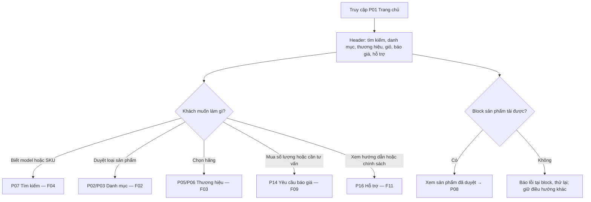

### F02 — Duyệt theo loại

Điểm vào: menu/P02/URL danh mục. Bộ lọc kỹ thuật chỉ xuất hiện khi phạm vi loại hàng rõ.

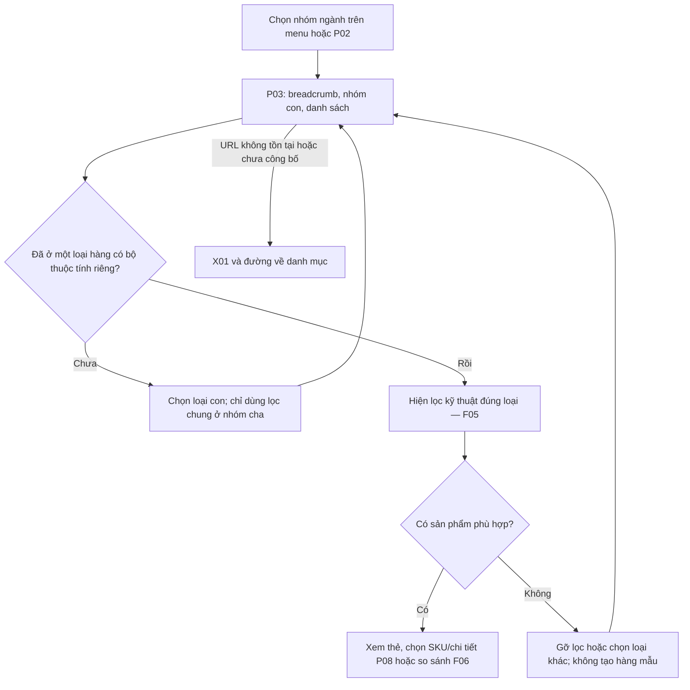

### F03 — Duyệt theo thương hiệu

Điểm vào: P05 hoặc tên hãng trên sản phẩm. Kết thúc: P08 với đúng SKU hoặc giữ danh sách đã lọc.

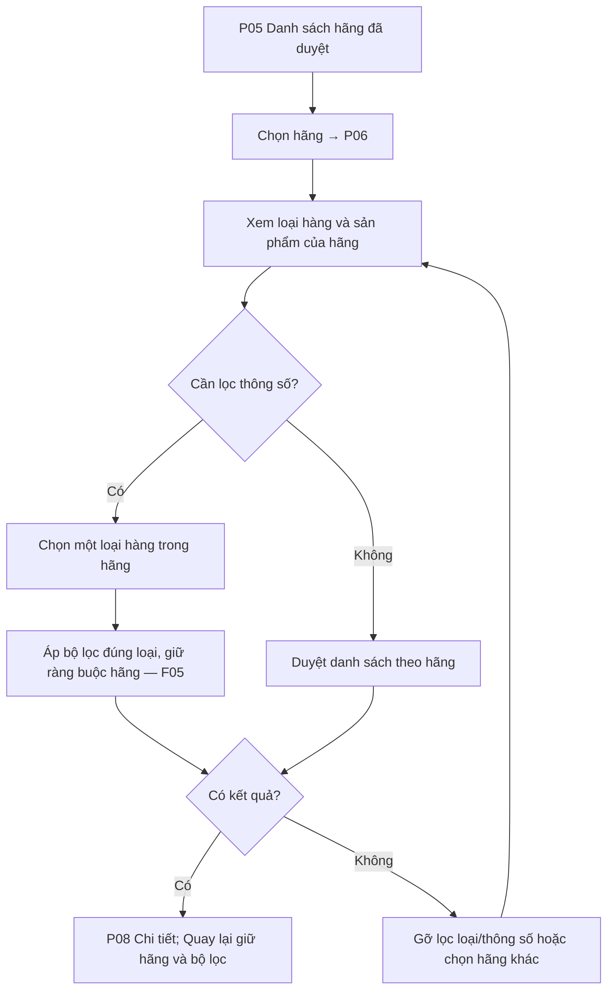

### F04 — Tìm theo model/SKU/tên/thương hiệu

Điểm vào: ô tìm trên header hoặc hỗ trợ. Không tự mở/mua model khác nếu gần giống mã khách tìm.

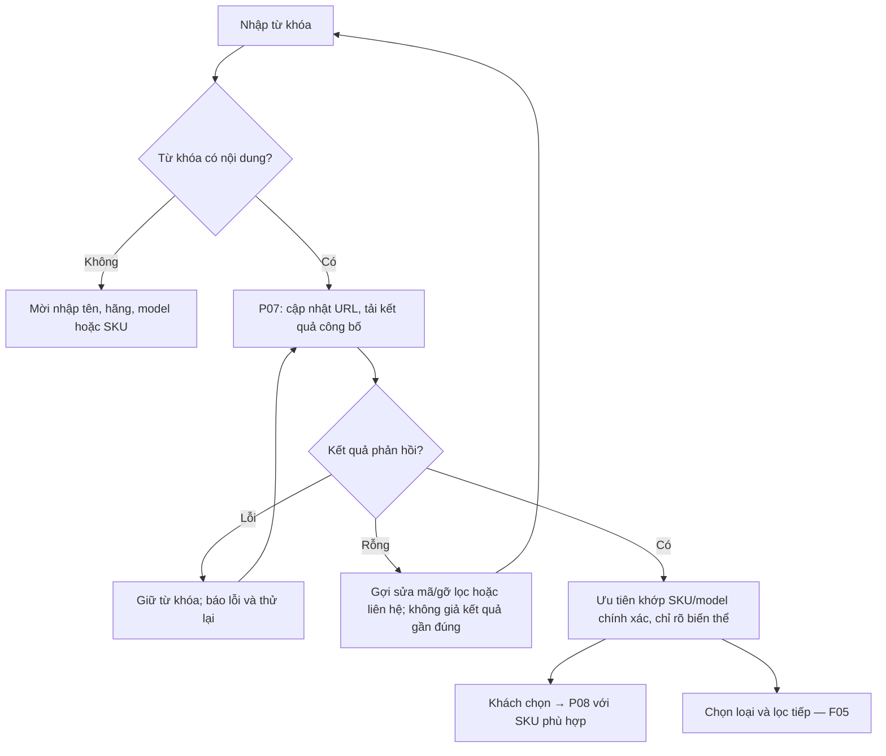

### F05 — Lọc thông số

Điểm vào: P03/P04/P06/P07. Kiểm tra cùng SKU đáp ứng toàn bộ tổ hợp; không ghép thuộc tính từ nhiều biến thể.

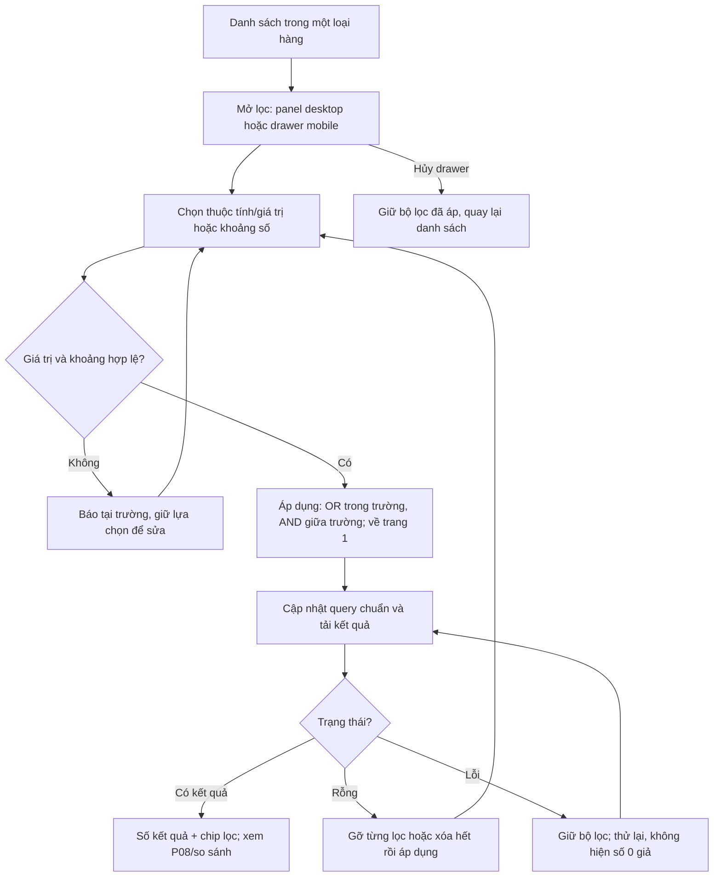

Desktop có thể áp ngay một lựa chọn hoặc dùng nút áp theo thiết kế Giai đoạn 04; trạng thái URL chỉ biểu diễn bộ lọc đã áp, không chứa bản nháp mobile. Back/Forward không bị mất ngữ cảnh lọc.

### F06 — Xem và so sánh

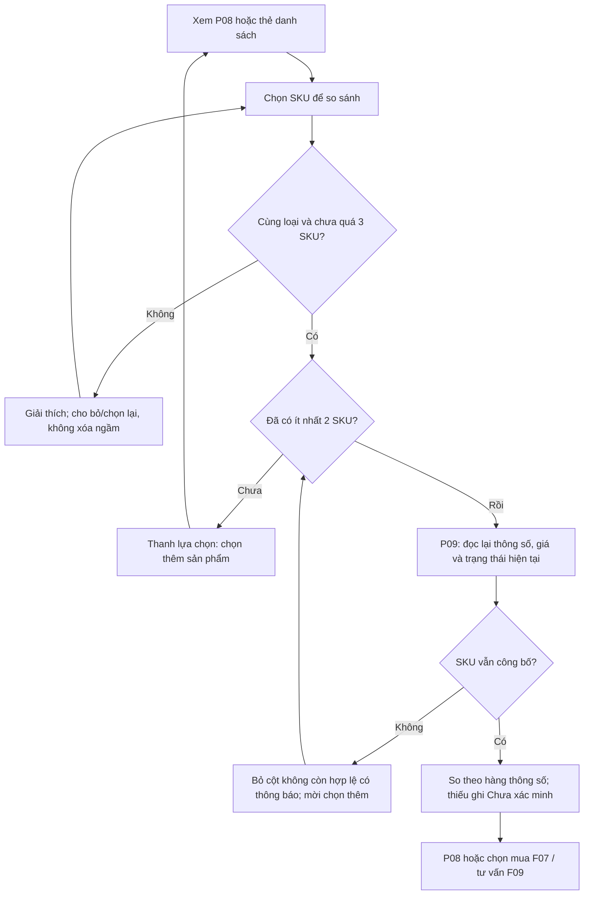

### F07 — Thêm giỏ hoặc mua ngay

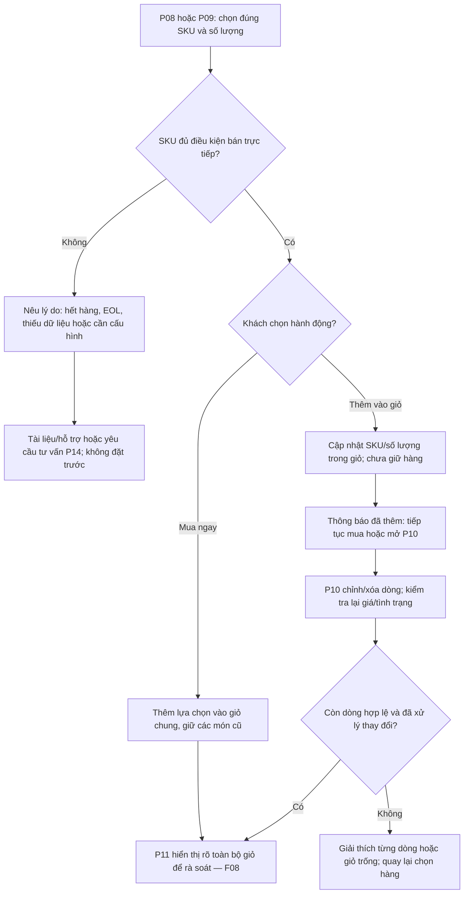

MVP không có bundle tự thêm, phụ kiện tự suy luận hoặc ép mua kèm. Kiểm tra trước thêm giỏ giúp UX nhưng kiểm tra cuối của server ở checkout mới quyết định có tạo đơn được không.

### F08 — Đặt hàng, nhận mã đơn và theo dõi

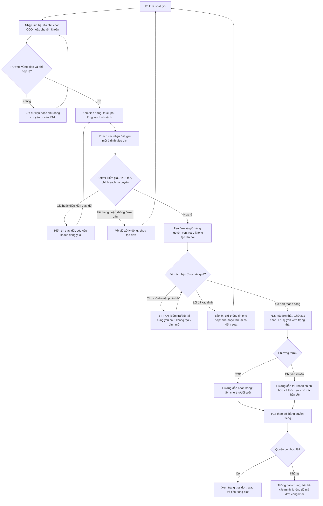

Mở P12 trực tiếp không tạo đơn và không lấy đơn gần nhất của người khác. Refresh receipt chỉ đọc lại kết quả đã có. Thời hạn giữ hàng hết hoặc tiền đến muộn đi vào đối soát theo PRD; không tự khôi phục cam kết hàng.

### F09 — Yêu cầu báo giá B2B

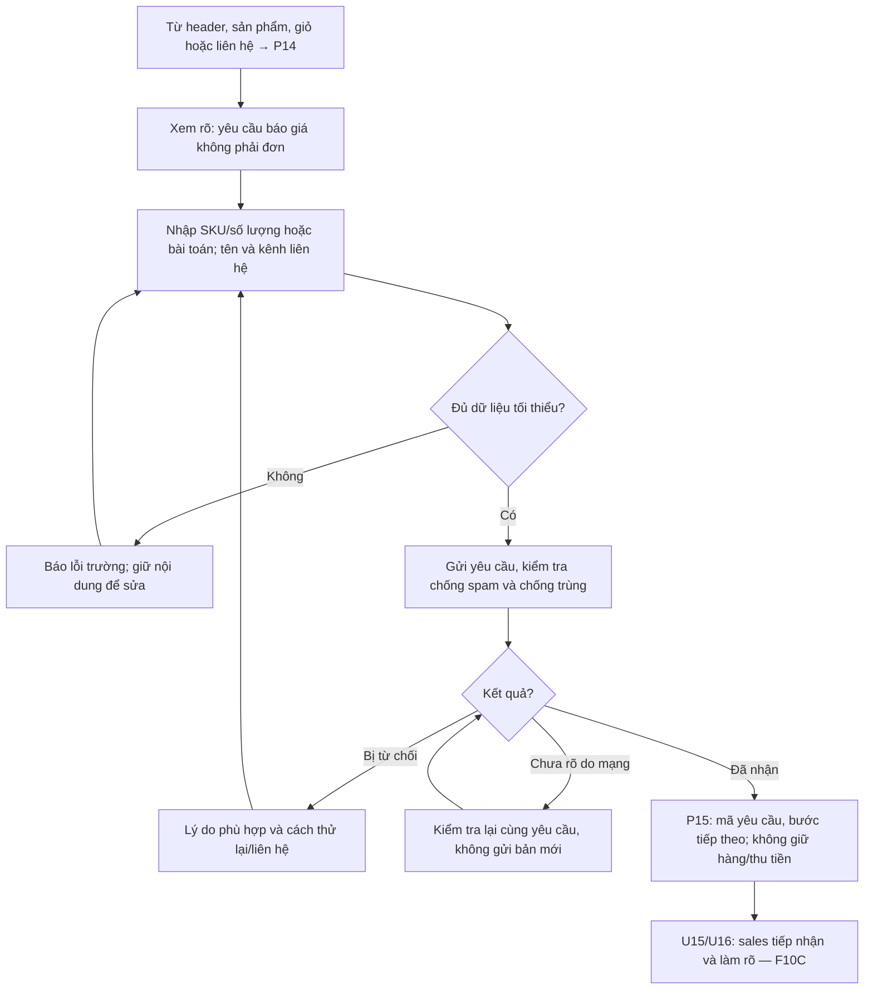

Không tạo trang công khai cho giá riêng/phiên bản báo giá. Khách nhận báo giá do nhân viên gửi theo kênh được duyệt; chưa có tài khoản B2B, upload file hoặc ký điện tử.

### F10A — Admin quản lý catalog

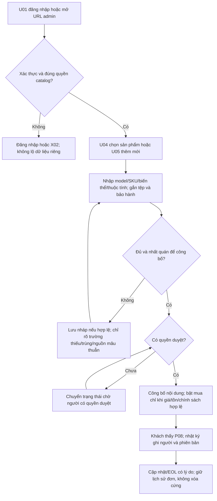

Danh mục, thương hiệu, thuộc tính, giá, tồn và tệp được quản lý qua U06–U12 đúng quyền. Nếu có người khác vừa sửa, phải giải quyết xung đột trước công bố; nút lưu không được ghi đè bản mới âm thầm.

### F10B — Admin quản lý đơn, kho và tiền

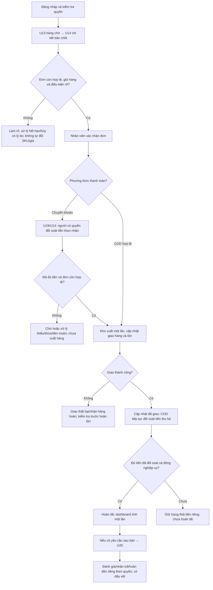

Hủy trước xuất giải phóng lượng giữ đúng một lần; đã xuất thì xử lý hàng trả, không cộng tồn ngay khi bấm hủy. Tiền đến sau hết hạn không tự cấp lại hàng. Hoàn tiền thủ công cần ghi bằng chứng thực nhận/thực hoàn; sơ đồ không thực hiện gửi tiền hoặc liên hệ khách.

### F10C — Admin quản lý yêu cầu và báo giá

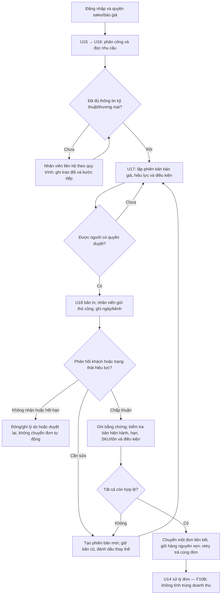

Đọc/báo giá chưa giữ hàng. Giá chuyển đơn là giá báo đã duyệt, không tự đổi về giá công khai; điều kiện thay đổi cần làm rõ/phê duyệt lại. Nếu lỗi tạo đơn, không để lại giữ hàng hoặc đơn dở dang.

### F11 — Hướng dẫn sử dụng và chính sách bảo hành

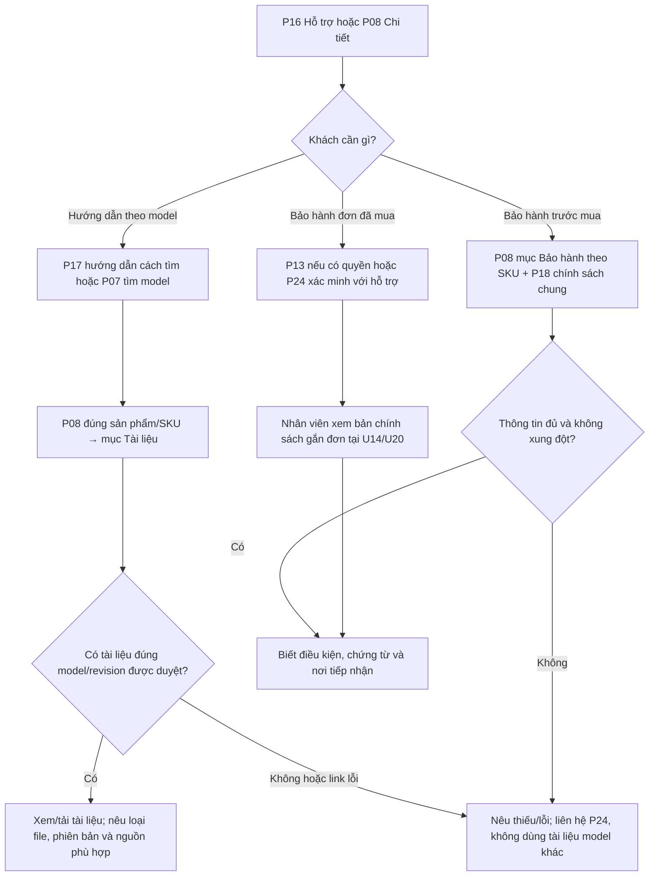

Chính sách hiện tại trên P18 không thay cam kết của đơn cũ. MVP không có tra cứu bảo hành bằng serial công khai; nhân viên hỗ trợ xác minh và lập hồ sơ theo quyền. Không tải hàng loạt hoặc tự nhập tài liệu XTREND.

## 10. Mở rộng về sau — không hiển thị trong navigation MVP

| Phiên bản/chức năng | Dự kiến vị trí khi được triển khai | Giới hạn |
|---|---|---|
| V1.1 C12 quan hệ được duyệt | Section trong P08, không cần route riêng | Chỉ nguồn do kỹ thuật duyệt; chưa tự suy tương thích |
| V1.1 C13 bài tư vấn | `/tu-van/`, `/tu-van/{article-slug}/`; admin khu vực bài viết mới | Không đồng nhất với P17 hướng dẫn sử dụng cơ bản |
| V1.1 A11 CSV | `/quan-tri/nhap-du-lieu/` khi chức năng được duyệt triển khai | Xem trước/kiểm lỗi trước ghi; không làm trong MVP |
| V1.1 S07 email | Không cần trang khách mới; hàng chờ gửi trong admin sau này | Không bật tự gửi chỉ vì đã có màn hình receipt |
| V1.2 C14 tài khoản | `/tai-khoan/` và các route xác thực sẽ thiết kế riêng | Không tạo trang đăng ký/đăng nhập khách ở MVP |
| V1.2 C15/A12/A13/S10 | Mở rộng tìm kiếm, nhập dữ liệu, khuyến mãi, thanh toán | Cần thiết kế phiên bản riêng; không đặt link “sắp ra mắt” giả ở checkout |
| Nghiên cứu C16/C17/C18/C19/S08/S09 | Chưa định tuyến công khai | Runtime UPS, tự suy tương thích, đại lý, chi phí in, sàn, đa kho/ERP chưa đủ điều kiện |

UPS Offline riêng, nhóm ASUS/Advantech cụ thể và vật tư/phụ kiện chưa xác minh được giữ trong catalog plan nội bộ. Có thể mở thêm loại bằng P03 mà không đổi cấu trúc sản phẩm/thương hiệu khi đủ dữ liệu và được doanh nghiệp duyệt.

## 11. Truy vết và quyết định còn mở

### 11.1. Đủ 11 luồng yêu cầu

| Yêu cầu PROMPT 03 | Luồng | Trang chính | Chức năng/AC liên quan |
|---|---|---|---|
| 1. Truy cập trang chủ | F01 | P01 | C01, C09, C11, S03 |
| 2. Duyệt theo loại | F02 | P02–P04 | C01, C03 |
| 3. Duyệt theo hãng | F03 | P05–P06 | C01–C03 |
| 4. Tìm model/SKU | F04 | P07–P08 | C02, C04 |
| 5. Lọc thông số | F05 | P03/P04/P06/P07 | C03, A02 |
| 6. Xem/so sánh | F06 | P08–P09 | C04–C05 |
| 7. Thêm giỏ | F07 | P08–P11 | C06–C07 |
| 8. Đặt/nhận mã | F08 | P11–P13 | C07–C08, C10, S01–S02 |
| 9. Báo giá B2B | F09 | P14–P15 | C09, A09 |
| 10. Admin sản phẩm/đơn/báo giá | F10A/F10B/F10C | U01–U24 theo quyền | A01–A10, S01–S02, S05–S06 |
| 11. Hướng dẫn/bảo hành | F11 | P16–P24, P08, U14/U20 | C04, C11, A04, A07 |

Mọi mục Must đã có nơi thể hiện: C01–C11 ở P; A01–A10 ở U; S01 thể hiện ở F08/F10B/F10C; S02 ở quyền và private states; S03 ở điều hướng/trạng thái; S04 ở URL/index; S05 ở điều kiện vận hành/khôi phục và U23 theo phạm vi; S06 ở U03 và mốc nghiệp vụ. Không tạo màn hình mới chỉ để đủ một mã hệ thống.

### 11.2. Điểm cần chốt trước các giai đoạn tiếp theo

| Mã | Quyết định/đầu vào | Trạng thái và mốc |
|---|---|---|
| IA01 | Tên thương hiệu/domain/logo và nội dung pháp nhân | Chưa xác minh; trước thiết kế thương hiệu/xuất bản |
| IA02 | Danh mục/brand/SKU thực sự có trong đợt ra mắt | D02 còn mở; cây là khả năng tổ chức, không phải xác nhận hàng |
| IA03 | Chính sách/đầu mối hỗ trợ/hướng dẫn có quyền dùng | D09–D10 còn mở; trước xuất bản nội dung thật |
| IA04 | Thời hạn giữ hàng, phí/vùng/COD và quy tắc tiền | D03–D06 còn mở; sơ đồ dùng nguyên tắc PRD, trước GĐ05 cần tham số cụ thể |
| IA05 | Cách cấp/khôi phục/quản lý quyền xem đơn | D07 còn mở; route sạch đã xác định, giao thức bảo mật chốt GĐ05 |
| IA06 | SLA và thẩm quyền báo giá/gửi/ghi chấp thuận | D08/D10 còn mở; trước thiết kế nghiệp vụ kỹ thuật liên quan |
| IA07 | Cách render/crawl, canonical/index, liên kết file và status HTTP thực tế | Định hướng ở mục 3; kiểm chứng trong stack đã chọn ở GĐ05, không mặc định SPA đáp ứng |
| IA08 | Chi tiết responsive, focus, bảng so sánh và form | Đầu vào GĐ04; chưa chọn visual hoặc viết UI |

Các điểm trên không chặn việc bàn giao sitemap này. Chúng phải được chốt trước các bước phụ thuộc, không được tự điền dữ liệu thương mại hoặc quyền kinh doanh để hoàn thành sơ đồ.

## 12. Checklist nghiệm thu Giai đoạn 03

### Đã rà soát ở mức tài liệu

- [x] Có sitemap cây cho storefront, hỗ trợ/chính sách, giao dịch và admin; tương lai tách khỏi MVP.
- [x] Có 26 mục trang khách P01–P26 và 24 mục admin U01–U24, cùng X01–X03; mỗi mục có URL/nội dung/hành động/giới hạn và truy vết.
- [x] Danh mục và thương hiệu có namespace riêng; một URL chính cho sản phẩm, không phụ thuộc nhánh danh mục.
- [x] Có quy tắc slug/biến thể/query/filter/sort/phân trang, back/forward, breadcrumb và quay lại kết quả.
- [x] Có phân biệt index, noindex, canonical và sitemap.xml; không dùng SEO để thay bảo vệ dữ liệu.
- [x] Có điều hướng desktop/mobile/admin và hành vi drawer, so sánh, checkout theo phạm vi MVP.
- [x] Đủ 11 luồng, thể hiện bằng 13 sơ đồ Mermaid do luồng admin tách thành 3 phần.
- [x] Mua trực tiếp, báo giá và hỗ trợ EOL/hết hàng có kết quả khác nhau; mã yêu cầu không gọi là mã đơn.
- [x] Có trạng thái loading/empty/error, lỗi quyền, xung đột sửa và giao dịch chưa rõ kết quả.
- [x] P12/P13/P15 không hiển thị receipt/dữ liệu riêng khi mở trực tiếp thiếu ngữ cảnh/quyền.
- [x] Không đưa CMS bài viết, tài khoản khách, email tự động, import hoặc engine tư vấn vào MVP.
- [x] Không sao chép URL XTREND như yêu cầu; không viết code hoặc chạy test ứng dụng.

Các dấu trên chỉ xác nhận sự hiện diện và kiểm tra nhất quán tài liệu; không phải nghiệm thu UI, kiểm thử giao dịch hoặc xác nhận đã render các sơ đồ ở mọi trình xem Markdown.

### Người dùng rà soát thiết kế

- [ ] Đồng ý cây điều hướng và các namespace URL của website mới.
- [ ] Đồng ý cách tách mua trực tiếp/báo giá và hành vi Mua ngay giữ giỏ hiện có.
- [ ] Đồng ý cấu trúc hỗ trợ: tài liệu theo sản phẩm/model trong MVP, bài tư vấn ở phiên bản sau.
- [ ] Đồng ý các trang/quyền admin và đường đi ba luồng quản trị.
- [ ] Ghi các thay đổi cần có trước Giai đoạn 04; không tự đánh dấu dữ liệu IA/D còn mở là đã xác minh.

**Điểm dừng:** bàn giao SITEMAP.md và cập nhật PROJECT_CONTEXT.md; chờ người dùng rà soát hoặc yêu cầu giai đoạn tiếp theo. Chưa tạo DESIGN.md, schema/API, code hay triển khai website.
