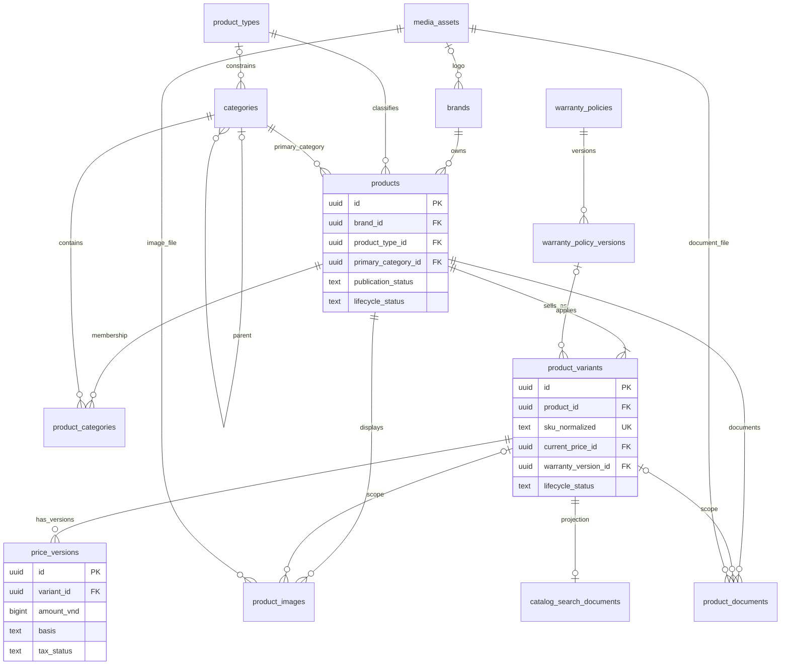
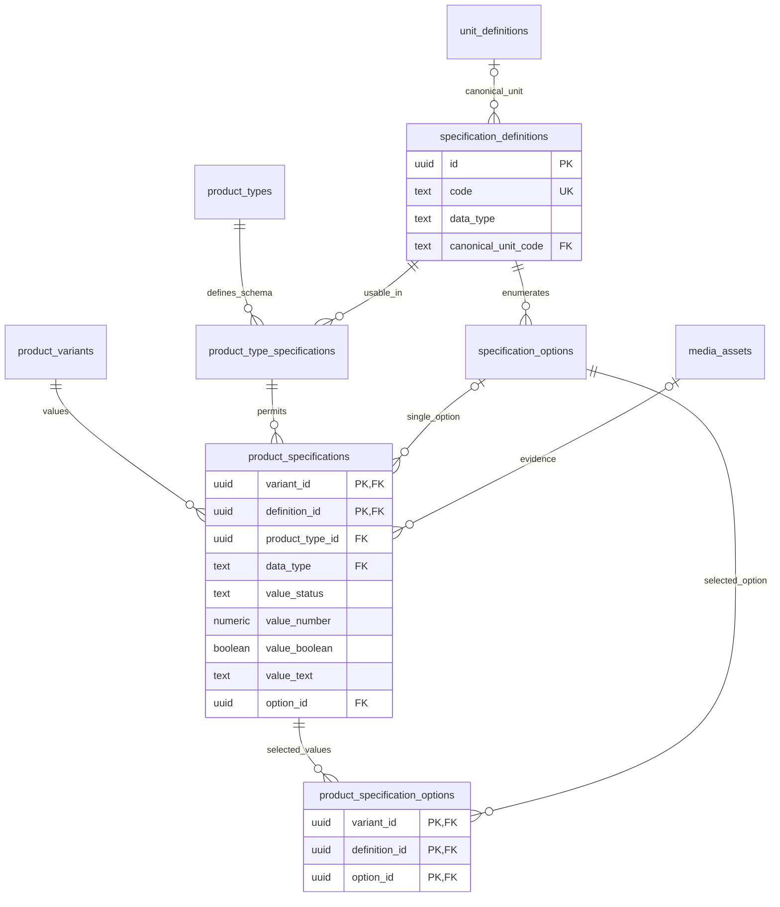
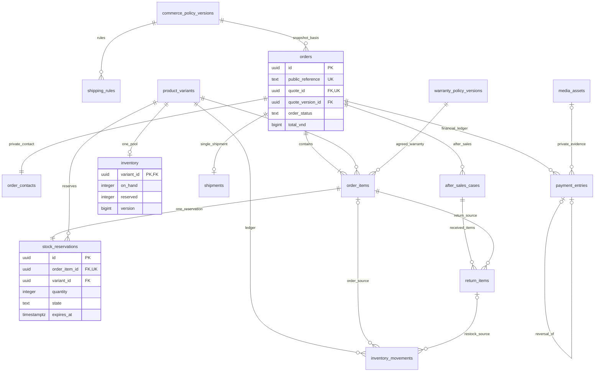
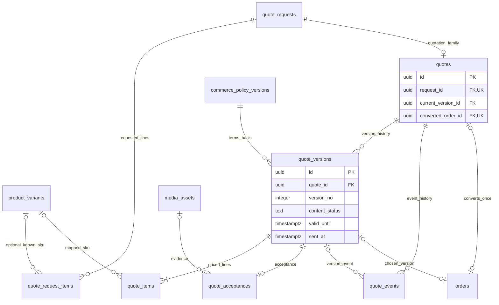
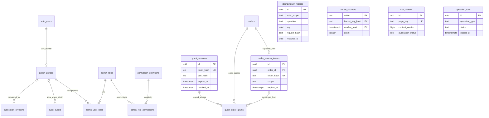

# ERD — Quan hệ dữ liệu

Giai đoạn 05, cập nhật 08.2: đã tạo 52 bảng trên Supabase local. Chi tiết thực tế ở [SCHEMA.md](../supabase/SCHEMA.md), thiết kế ở [DATABASE.md](../DATABASE.md), quyền nền ở [SECURITY.md](SECURITY.md). Các sơ đồ chia theo miền để đọc được, không phải nhiều database tách rời.

Ký hiệu Mermaid: `||` đúng một, `o|` không hoặc một, `o{` không hoặc nhiều, `|{` một hoặc nhiều. Một số bảng hiển thị lại giữa sơ đồ để nối miền. Audit/idempotency có tham chiếu đa loại được kiểm soát trong RPC; không giả rằng chuỗi entity_id là FK SQL tới mọi bảng.

## 1. Sản phẩm, danh mục, giá và bảo hành

`current_price_id` trỏ một price_version của chính SKU, được FK kép bảo vệ; sơ đồ chỉ vẽ cạnh sở hữu để tránh vòng khó đọc. Warranty có thể chưa gắn ở draft, nhưng publish/checkout cần điều kiện tương ứng. Product phải có ít nhất một SKU ở lúc publish; cardinality minimum này được kiểm bằng publication gate.

## 2. Thuộc tính nhiều ngành

FK kép xác thực type/SKU/definition. Các cột typed là lựa chọn có điều kiện, không có nghĩa mỗi hàng chứa đồng thời mọi kiểu. Unknown/not-applicable/not-supported không mang giá trị giả. Multi-enum có child rows; scalar có XOR constraint theo kiểu.

## 3. Đơn, tồn, tiền và sau bán

Inventory có thể chưa tồn tại cho draft SKU; SKU được bán phải có inventory row hợp lệ. Reservation được tạo cùng order item; khi hết hạn/hủy/xuất vẫn giữ hàng lịch sử ở state released/consumed, không xóa để tạo lại. Payment và stock không đồng nghĩa: refund không tự restock.

## 4. RFQ, báo giá và chuyển đơn

Version có ít nhất một priced line khi gửi/chuyển, draft có thể chưa đủ. `current_version_id` phải thuộc root. Ghi accepted không sửa nội dung sealed; convert chỉ khi tất cả dòng đã map SKU hợp lệ. Hai chiều liên kết quote/order là consistency invariant kiểm trong transaction; có thể triển khai một FK có thẩm quyền và một view thay cột dư nếu review implementation cho thấy ít rủi ro hơn, nhưng unique một root → một order phải giữ.

## 5. Admin, guest và hạ tầng dữ liệu

`auth_users` là biểu diễn `auth.users` do Supabase quản lý, không tạo bảng thay thế. Guest session không tham gia Auth/account và không có quyền tự sửa/hủy đơn. Bảng idempotency liên kết kết quả bằng loại resource + ID và actor scope server xác định; invariants được kiểm trong RPC. `site_content`, `operation_runs`, `abuse_counters` không cần FK giả chỉ để nối hình.

Các sơ đồ đã đối chiếu tên bảng với data dictionary. 08.2 đã chạy migrations và test referential integrity trên PostgreSQL local. Quan hệ chuyển quote dùng `orders.quote_id` làm nguồn duy nhất, không tạo cột ngược dư `quotes.converted_order_id`. Các cardinality ở thời điểm publish/checkout và chuyển trạng thái còn cần RPC theo [phạm vi bàn giao](../docs/MODULE_08_1_2.md).
